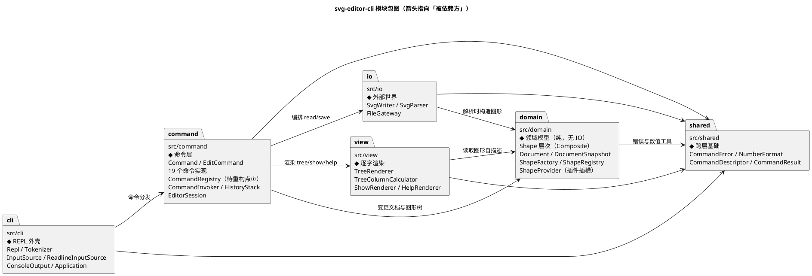
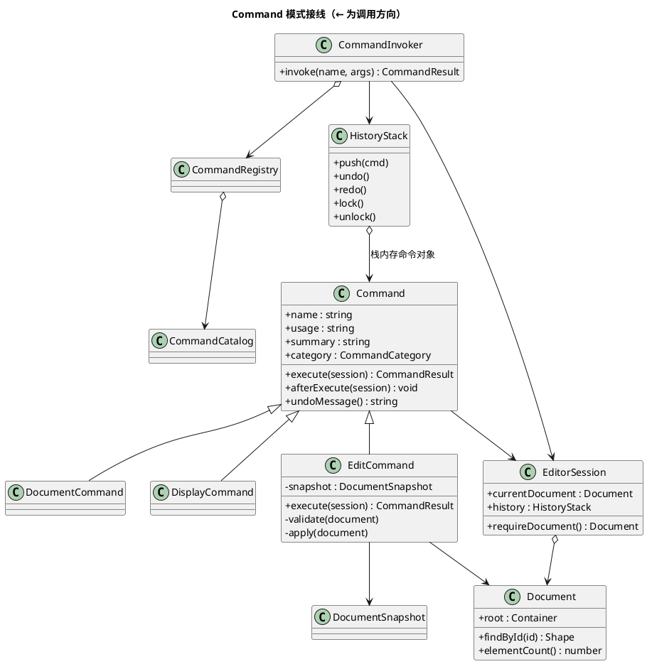

# svg-editor-cli — Lab1 Phase 1 交付文档

> **纯终端 SVG 结构化编辑器**（TypeScript + 面向对象 + Command 模式）
> 高级软件开发课程 Lab1 Phase 1 · 作业规格：`phase_cli_1.md`

本文档即作业要求的最终提交物，包含四节：**架构方案**、**过程记录**、**一致性自查**、**质量保证手段**。

---

## 目录

- [0. TL;DR](#0-tldr)
- [1. 架构方案](#1-架构方案)
  - [1.1 模块划分](#11-模块划分)
  - [1.2 设计模式的选择与落地](#12-设计模式的选择与落地)
  - [1.3 依赖方向规则](#13-依赖方向规则)
  - [1.4 变化点假设](#14-变化点假设)
- [2. 过程记录](#2-过程记录)
- [3. 一致性自查](#3-一致性自查)
- [4. 质量保证手段](#4-质量保证手段)
- [附录](#附录)

---

## 0. TL;DR

### 一句话

一个**用 id 寻址、以命令为单位可撤销**的 SVG 结构化编辑器：每条命令即时回显逐字确定的结果摘要，编辑动作按「一条命令 = 一个撤销单元」回退，`save` 出来的是浏览器可直接打开的标准 SVG。

### 交付概览

| 项 | 结果 |
|---|---|
| 源代码 | `src/` **66** 个 TypeScript 文件（6 个模块目录），一类一文件 |
| 设计模式 | Command（作业必选）+ Memento + Composite + Factory/Provider + Template Method + Registry |
| 测试 | **19** 个测试文件 / **275** 条用例 / **全绿** |
| 覆盖率 | 语句 **89.39%** · 分支 **90.40%** · 函数 **92.83%** · 行 **89.39%** |
| 逐字契约 | 规格 §6 完整 transcript **逐字节相等**；§6.1 流程图会话逐字相等 |
| 架构约束 | 零 `switch(tag)`、零 `box` 实现、依赖方向矩阵零违规 |
| 需求覆盖 | PRD **55** 条需求 + **18** 条错误文案 + **25** 条逐字会话契约，全覆盖 |
| 缺陷闭环 | 独立验收发现 **8** 个缺陷（P0 0 / P1 1 / P2 7）→ **全部闭环** |
| Git 历史 | **17** 个提交，分步推进；`final` tag 已打在最终提交上 |

### 快速开始

```bash
npm install
npm run cli        # 启动 REPL，提示符 svg>
```

```text
svg> init 800 600
canvas 800x600 created
svg> create rect bg 0 0 800 600 #ffffff
rect#bg created
svg> create text title 20 40 "My Diagram"
text#title created
svg> group markers bg title
g#markers created with 2 children
svg> tree
svg (800x600)
└── g#markers
    ├── rect#bg        x=0 y=0 w=800 h=600 fill=#ffffff
    └── text#title     (20,40) "My Diagram"
svg> save demo.svg
saved to demo.svg (3 elements)
```

### 质量闸门（复现方式）

```bash
npm run typecheck    # tsc -p tsconfig.test.json —— 零错误
npm test             # vitest run —— 275/275
npm run check:deps   # 依赖方向 + 硬约束扫描 —— 零违规
npm run test:coverage
```

---

## 1. 架构方案

### 1.1 模块划分

分 **6 个目录模块**，每层职责单一、依赖单向。几何知识只存在于形状子类中，渲染器与命令层不含任何按标签的分支。

| 模块（目录） | 一句话职责 | 层 | 文件数 |
|---|---|---|:--:|
| `src/shared/` | 跨层共享的最小基础：异常类型、数值格式化、命令描述符与结果载体 | 基础层 | 5 |
| `src/domain/` | 纯领域模型：形状层次（Composite）、文档、形状工厂与类型注册表、撤销快照 | 领域层 | 16 |
| `src/io/` | 与外部世界打交道：SVG 序列化 / 反序列化、文件读写网关 | 基础设施层 | 4 |
| `src/view/` | 把领域对象渲染成**逐字确定**的文本：tree / show / help | 表现层 | 4 |
| `src/command/` | Command 模式宿主：命令抽象与 19 个实现、命令注册表、Invoker、历史栈、会话状态 | 应用层 | 29 |
| `src/cli/` | REPL 外壳：读行、分词、控制台输出、依赖装配与启动 | 交互层 | 7 + 入口 |

**模块包图**（箭头指向「被依赖方」）



**各模块关键文件**

| 模块 | 关键文件 | 职责 |
|---|---|---|
| `shared` | `CommandError.ts` | 承载**用户可见错误消息**的异常类型（消息不含 `error: ` 前缀，前缀只由 CLI 加一次） |
| | `NumberFormat.ts` | 唯一的数值 → 字符串出口（整数不带 `.0`、浮点去噪到 10 位） |
| | `CommandDescriptor.ts` | 命令的**纯数据描述**（name/usage/summary/category），供 `help` 渲染且不依赖命令实现 |
| | `CommandResult.ts` | 命令返回值载体（输出行 + 警告行），避免命令直接写 stdout |
| `domain` | `Shape.ts` | 形状抽象基类：id、paint、属性访问器表、**泛型** `translate`/`scaleBy`/`getAttribute`/`setAttribute`、抽象 `describeForTree`/`describeForShow`/`toSvgXml`/`clone` |
| | `Container.ts` | 容器抽象基类：子节点集合，并**覆写** `translate`/`scaleBy` 为递归（Composite 语义的落点） |
| | `Group.ts` / `Document.ts` | `<g>` 容器 / 当前文档（根容器即 `<svg>` + 画布尺寸 + id 索引 + 元素计数 + 快照恢复） |
| | `Rect/Circle/Ellipse/Line/Text.ts` | 五种叶子图形：各自声明参数 schema（静态）与属性访问器（实例），**几何知识只存在于这 5 个文件内** |
| | `ShapeProvider.ts` / `ShapeRegistry.ts` / `ShapeFactory.ts` | **插件插槽接口** + 类型注册表 + 类型名 → 实例的唯一入口 |
| | `DocumentSnapshot.ts` | **Memento**：文档的不可变深拷贝，`capture()` / `restoreTo()` |
| `io` | `SvgWriter.ts` / `SvgParser.ts` | 文档 ↔ SVG 文本；解析侧负责缺 id 自动补齐与未建模属性的显式告警 |
| | `SvgParseResult.ts` / `FileGateway.ts` | 解析结果载体（文档 + 告警行）/ 文件读写网关 |
| `view` | `TreeRenderer.ts` / `TreeColumnCalculator.ts` | 结构树渲染 / **列对齐规则的唯一实现**（不认识任何图形类型） |
| | `ShowRenderer.ts` / `HelpRenderer.ts` | 单图形明细 / 命令帮助（只依赖 `shared` 的描述符接口） |
| `command` | `Command.ts` / `EditCommand.ts` | 命令抽象基类 / 编辑类基类（模板方法 `execute()`） |
| | `DocumentCommand.ts` / `DisplayCommand.ts` | 文档类基类（执行后锁死 undo/redo）/ 显示类基类（不产生 undo 单元） |
| | `CommandRegistry.ts` / `CommandCatalog.ts` | **待重构点①**：命令名 → `CommandSpec` 的注册表 / 19 条内建命令清单 |
| | `CommandInvoker.ts` / `HistoryStack.ts` / `EditorSession.ts` | **Invoker** / undo-redo 双栈与 IO 锁 / 会话状态（当前文档、当前路径） |
| | `commands/`（19 个） | 一类一文件的命令实现 |
| `cli` | `Repl.ts` / `Tokenizer.ts` / `Token.ts` | REPL 主循环 / 分词 / token 值对象 |
| | `InputSource.ts` / `ReadlineInputSource.ts` | **输入端口**（使 REPL 可被测试完整驱动） |
| | `ConsoleOutput.ts` / `Application.ts` / `src/index.ts` | 输出端口 / 组合根 / 进程入口 |

---

### 1.2 设计模式的选择与落地

#### 1.2.1 模式总表

| 模式 | 必选/自选 | 落地位置（类 → 文件） | 一句话理由 |
|---|---|---|---|
| **Command** | **必选（作业硬性要求）** | `Command` / `EditCommand` / `DocumentCommand` / `DisplayCommand` + 19 个命令 → `src/command/**` | undo/redo 的天然载体；命令是对象而非字符串分支 |
| **Memento** | 自选（与 Command 配套） | `DocumentSnapshot` → `src/domain/DocumentSnapshot.ts` | 撤销单元用快照承载，避免 19 份手写逆操作 |
| **Composite** | 自选（规格要求） | `Shape` / `Container` / `Group` → `src/domain/Shape.ts`、`Container.ts`、`Group.ts` | 容器与叶子统一操作接口 |
| **Factory / Provider** | 自选（承载插件缝隙） | `ShapeProvider` / `ShapeRegistry` / `ShapeFactory` → `src/domain/**` | 类型名 → 实现；未来 `box` 插件零内核改动 |
| **Template Method** | 自选 | `EditCommand.execute()` → `src/command/EditCommand.ts` | 统一「校验→快照→执行→回滚」骨架，子类只写业务 |
| **Registry（自研轻量）** | 自选 | `CommandRegistry`、`ShapeRegistry` | 把「按名字分派」从 switch 收敛到唯一可替换的数据结构 |
| Builder | 不采用 | — | `create` 是固定位置参数，schema 表驱动更简单 |
| Visitor | 不采用 | — | 会把几何知识搬出 `Shape`，形成「两份知识」 |
| Observer | 不采用 | — | 无多方订阅需求 |
| Iterator | 不采用 | — | 子节点集合用数组 + 只读视图即可 |
| State | 不采用 | — | 命令差异用类层次表达，而非运行时状态切换 |
| Singleton | 不采用 | — | 全局状态会让 undo 快照语义与测试同时失控 |

#### 1.2.2 Command 模式（作业硬性要求）

**GoF 三角色 → 本项目的对应**

| GoF 角色 | 本项目 | 位置 | 说明 |
|---|---|---|---|
| **Command**（抽象命令） | `Command` + `EditCommand` / `DocumentCommand` / `DisplayCommand` | `src/command/Command.ts` 等 4 个骨架文件 | 统一 `name`/`usage`/`summary`/`category`/`execute()`；三个子类分别表达「编辑 / 文档 / 显示」三种生命周期语义 |
| **ConcreteCommand**（具体命令） | 19 个命令类 | `src/command/commands/*.ts`（19 文件，一类一文件） | 每个命令封装「校验 + 变更 + 回显文案」，可独立 undo/redo |
| **Invoker**（调用者） | `CommandInvoker` | `src/command/CommandInvoker.ts` | 解析命令名 → 取 spec → 建实例 → `execute()` → `afterExecute()`（历史栈与 IO 锁的编排点）。**不认识任何具体命令，无 category 分支** |
| **Receiver**（接收者） | `Document` + Shape 树 | `src/domain/` | 真正被变更的对象；命令只调用它的公开方法 |
| （配套）**Memento** | `DocumentSnapshot` | `src/domain/DocumentSnapshot.ts` | 撤销单元的载体 |
| （配套）**历史栈** | `HistoryStack` | `src/command/HistoryStack.ts` | undo 栈 / redo 栈 / IO 锁 |

**接线图**



**一条编辑命令的生命周期**（模板方法，`EditCommand.execute()`）

```text
1. requireDocument()            → 无文档：E-12，未改任何状态
2. validate(document)            → 只读校验：id 冲突 / 目标不存在 / 类型不符 / 参数非法
3. before = DocumentSnapshot.capture(document)      ← 快照即撤销单元（Memento）
4. try { result = apply(document) }                 ← 唯一的变更点
   catch (e) { before.restoreTo(document); throw e } ← 兜底回滚，保证失败原子性
5. this.snapshot = before
6. afterExecute(session)         → 入 undo 栈、清空 redo 栈、解锁 IO 锁
```

**undo / redo 的实现**

- **撤销单元 = 一条命令**。`HistoryStack` 的栈内存的是**命令对象本身**，命令自带一份快照。
- `undo` = 快照还原 + 命令自己产出回显文案 → 因此 undo 文案天然与命令语义贴合（`circle#c1 moved back to (100,100)`、`rect#box restored into g#markers`）。
- `redo` = 再次 `apply()` → 回显与首次执行**逐字相同**（规格要求）。
- **一条命令一个单元**：`group markers c1 box` 整体是一个单元，undo 一次同时复原两个元素的父容器与原位置。
- **IO 锁**：`init`/`read`/`save`/`canvas`（改尺寸）执行后 `history.lock()`，`undo`/`redo` 一律报 `error: undo not allowed after io command`；**下一次编辑命令执行时自动解锁**。锁优先于「栈空」（先报锁）。
- **显示类命令**（`tree`/`show`/`help`）不 push、不 lock、不 unlock。

**为什么用 Memento 快照而不是手写逆操作**：`group` / `ungroup` / `front` / `back` / `addto` 这五类命令要复原的不只是属性值，还有「原父容器 + 原索引」，手写逆操作极易漏项；快照法用**一条规则**覆盖全部 19 个命令，并且天然满足「命令失败不改变任何状态」与「redo 回显与首次一致」。

**其它模式的落地要点**

| 模式 | 落点 | 关键设计 |
|---|---|---|
| Composite | `Shape` → `Container` → `Group` / `Document` | `Container` 覆写 `translate`/`scaleBy` 为递归；`move`/`scale`/`set`/`delete` 对 `<g>` 与叶子**一视同仁**（Composite 语义）。用 `isContainer(): this is Container` 类型谓词代替 `instanceof`，避免各处重复判断 |
| Factory / Provider | `ShapeProvider`（接口）+ `ShapeRegistry` + `ShapeFactory` | 内建 6 型以「类自身静态成员」满足 Provider 接口（零额外文件）；`create` 命令**完全由 schema 驱动**，新增类型零改动接入；未注册类型走 E-05 逐字错误并自带 `(is the plugin loaded?)` 提示 |
| Template Method | `EditCommand.execute()` | 校验 → 快照 → apply → 回滚的骨架固定在基类，子类只写 `validate()` / `apply()` / `undoMessage()` |
| Registry | `CommandRegistry` / `ShapeRegistry` | 两处「按名字分派」的落点，均为 `Map` 查找，**全仓零 `switch`** |

#### 1.2.3 两处「按名字分派」——**待重构标注**

> 规格 §2.1 规定：按名字分派只允许两处，且必须在架构方案中显式标注为待重构。以下两处**已在源码中以 `// TODO(ARCH): 待重构点①/②` 标注**。

| # | 待重构点 | 位置 | 现状 | 问题 | 重构方向（后续阶段） |
|---|---|---|---|---|---|
| ① | **命令分发**（命令名 → 命令实现） | `src/command/CommandRegistry.ts` + `src/command/CommandCatalog.ts` | 已是注册表（`Map`）而非 `switch`；命令对象自带 `name`/`usage`/`summary`/`category`；但 `CommandCatalog` 仍是**中心清单**，且 `CommandSpec.create` 闭包把参数解析耦合在注册处 | 新增命令仍需改中心清单；插件无法自注册命令 | ① 参数解析**下沉到命令类**（`Command.parse(tokens)` 自解析），`CommandSpec` 只剩元数据；② 引入 `CommandProvider`，插件可 `registry.register(provider)` 自带命令；③ 长期形态：注册表由**能力声明**驱动（每条命令声明自己的参数 schema，Invoker 统一解析与报错），彻底消除中心清单 |
| ② | **图形工厂**（类型名 → 类） | `src/domain/ShapeFactory.ts` + `src/domain/ShapeRegistry.ts` | 已是 provider 化的注册表；内建类型以「类静态成员」满足 `ShapeProvider`；未注册类型抛 E-05 逐字错误 | 内建类型与插件类型注册方式不完全同构；`ShapeFactory` 同时承担「CLI 创建」与「XML 反序列化」两条路径入口 | ① 把「从 XML 属性构造」也纳入 `ShapeProvider`（`fromXml`），使 `SvgParser` 也只依赖接口；② 内建类型也各写一个 `XxxShapeProvider`（与插件完全同构，代价 +6 文件）；③ 长期形态：`ShapeProvider` 增加「复合图形能力」声明（子部件模板、`set` 传播策略、序列化标记），即规格 §4.4 的插件化目标 |

#### 1.2.4 规避 `switch(tag)` 的关键设计

规格禁止「到处 `switch(tag)` 的分派写法」。本项目的做法是：**几何知识只存在于形状子类里，渲染器一律通过多态自描述方法取数据，渲染器内不允许出现任何按标签的分支。**

| 角色 | 方法 | 返回 |
|---|---|---|
| Shape（多态） | `describeForTree(): ShapeSummary` | `header`（`tag#id`）+ `attributeLine`（tree 属性行整串，容器为空串） |
| Shape（多态） | `describeForShow(): ShapeSummary` | 同上，但为 show 明细行 |
| Shape（多态） | `toSvgXml(indent): string` | 该元素的 XML 片段 |

| 类型 | tree 属性行 | show 明细行 |
|---|---|---|
| `rect` | `x=0 y=0 w=800 h=600` + ` fill=#ffffff` | `x=0 y=0 width=800 height=600` / `fill=#ffffff` |
| `circle` | `cx=100 cy=100 r=20` + ` fill=red` | `cx=100 cy=100 r=20` / `fill=red` |
| `ellipse` | `cx=1 cy=2 rx=3 ry=4` + paint | `cx=1 cy=2 rx=3 ry=4` / paint |
| `line` | `(280,130) -> (520,130)` | `x1=280 y1=130 x2=520 y2=130` / `stroke=black` |
| `text` | `(20,40) "My Diagram"` | `x=20 y=40` / `text="My Diagram"` / paint |
| `g`（容器） | **无属性行**（不参与列宽计算） | `children=2` |

因此「新增一个图形类型」时**只有新形状类需要改**，渲染器与对齐器零改动。

---

### 1.3 依赖方向规则

#### 1.3.1 允许的依赖（逐条 + 理由）

| # | 允许 | 理由 |
|---|---|---|
| A1 | `shared` ← 其它任何模块 | 基础层零依赖（只含异常、数值格式化、纯数据描述符），是依赖图的汇点 |
| A2 | `domain` → `shared` | 领域层需要 `CommandError` 抛业务错误、需要 `NumberFormat` 统一数值口径 |
| A3 | `io` → `domain` | 解析器必须**构造领域对象**，序列化器必须**读取领域对象**；反向会污染领域模型 |
| A4 | `io` → `shared` | 需要 `CommandError`（E-10/E-11）与 `NumberFormat` |
| A5 | `view` → `domain` | 渲染器读取形状自描述（`describeForTree`/`describeForShow`）与文档结构 |
| A6 | `view` → `shared` | 需要 `NumberFormat` 与 `CommandDescriptor`（避免 view → command 形成环） |
| A7 | `command` → `domain` | 命令的 Receiver 就是文档与图形树 |
| A8 | `command` → `io` | `read`/`save` 是命令，必须编排文件与 SVG 转换；**io 不反向依赖 command**，故无环 |
| A9 | `command` → `view` | `tree`/`show`/`help` 是命令，产出文本由 view 渲染（保证渲染逻辑只有一份） |
| A10 | `command` → `shared` | 异常、结果载体、描述符 |
| A11 | `cli` → `command` | REPL 只做「读行 → 分词 → 交给 Invoker → 打印结果」，不认识任何具体命令 |
| A12 | `cli` → `shared` | 需要 `CommandError`（统一加 `error: ` 前缀）与 `CommandResult` |

#### 1.3.2 禁止的依赖（逐条 + 理由）

| # | 禁止 | 理由 / 一旦违反的后果 |
|---|---|---|
| F1 | `domain` → `io` / `cli` / `command` / `view` | 领域模型必须可脱离终端与文件系统被测试；一旦反向依赖，undo 快照与几何逻辑无法单测 |
| F2 | `domain` → `view` | 领域层不应知道「怎么被打印」；否则 `describeForTree` 会反向污染模型 |
| F3 | `command` → `cli` | 命令层不得直接读写 stdout/提示符；否则命令无法在测试中被断言 |
| F4 | `view` → `command` / `io` | view 只做「领域对象 → 文本」；否则 `help` 渲染会与命令实现耦合，且与 A9 形成环 |
| F5 | `io` → `command` / `view` | IO 只负责「字节 ↔ 领域对象」，不负责输出格式与命令语义 |
| F6 | `view` ↔ `io` | 互不相干：一者读模型，一者读写文件 |
| F7 | 任何模块 → 另一个模块的**具体实现**（只允许依赖其公开接口） | 避免实现细节外泄，保证可替换（如 `FileGateway` 可换内存实现做测试） |
| F8 | 任何模块 → **全局单例 / 全局可变状态** | undo 需要「可回滚的会话状态」，全局状态会让快照语义失效 |
| F9 | `domain` / `view` → 任何 **IO API**（fs / process / readline） | 同 F1/F2 |
| F10 | 任何模块内的 **`switch(tag)` 分派**（除 §1.2.3 两处注册表内的名字查找） | 违反「禁止到处 switch(tag) 分派」的硬性要求 |

#### 1.3.3 依赖矩阵

行 = 依赖方，列 = 被依赖方；`✔` 允许、`✘` 禁止、`—` 自身。

| 依赖方 ＼ 被依赖 | `shared` | `domain` | `io` | `view` | `command` | `cli` |
|---|:--:|:--:|:--:|:--:|:--:|:--:|
| `shared`   | — | ✘ | ✘ | ✘ | ✘ | ✘ |
| `domain`  | ✔ | — | ✘ | ✘ | ✘ | ✘ |
| `io`      | ✔ | ✔ | — | ✘ | ✘ | ✘ |
| `view`    | ✔ | ✔ | ✘ | — | ✘ | ✘ |
| `command` | ✔ | ✔ | ✔ | ✔ | — | ✘ |
| `cli`     | ✔ | ✘ | ✘ | ✘ | ✔ | — |

> 矩阵无环：`shared ← domain ← io`、`shared ← domain ← view`、`command ← {domain, io, view}`、`cli ← command`。

#### 1.3.4 违规的可检查手段

| # | 手段 | 落地 |
|---|---|---|
| 1 | **脚本检查** | `scripts/check-deps.mjs` 按上表扫描 `src/**` 的 `import`，违规退出码非 0 → `npm run check:deps` |
| 2 | **脚本检查（硬约束）** | 同一脚本还核验：零 `switch (`、零 `\bbox\b`、一类一文件（文件名 = 类名） |
| 3 | **人工抽样** | 见本文档 §3.2 的抽样结论 |

> 两处豁免并已在脚本注释中写明理由：`src/cli/Application.ts`（组合根，按定义要装配各层）、`src/index.ts`（进程入口）。

---

### 1.4 变化点假设

| # | 未来最可能变化的地方 | 影响面 | **我为它留了什么** | 现在不做的理由 |
|---|---|---|---|---|
| V-01 | **新增图形类型**（规格 §4.4 的 `box` 复合图形、后续插件） | `create` 参数解析、tree/show 渲染、序列化 | ① `ShapeProvider` + `ShapeRegistry.register()` 为公开注册点；② `create` 完全由 schema 驱动（不 switch 类型），新类型零改动接入；③ tree/show 靠 Shape 多态自描述，新类型自动被支持；④ 未注册类型走 E-05 逐字错误并自带 `(is the plugin loaded?)` 提示 | 本阶段**禁止**出现任何 box 实现代码。`ShapeProvider` 只是通用插槽，不含 rect+text 模板、`data-kind`、传播语义等 box 专属信息 |
| V-02 | **新增命令** | 命令注册、help 文本 | `CommandSpec` 自带 name/usage/summary/category；`CommandCatalog` 单点登记；help 从描述符列表自动生成 | 无 |
| V-03 | **撤销粒度变化**（跨 IO 历史回退、批量合并撤销） | `HistoryStack` 语义 | 锁（`lock/unlock`）与栈（`push/undo/redo/clear`）分离；「IO 后禁 undo」只是 `lock()` 的一行策略 | 规格明确禁止跨 IO 回退 |
| V-04 | **画布坐标系 / viewBox 缩放策略** | `Document` 的 width/height/viewBox | 尺寸集中在 `Document`；`viewBox` 作为 `Document` 的字段而非散落在序列化器 | 已裁决「不缩放」，无需预留分支 |
| V-05 | **输出格式变化**（tree 列对齐、show 明细、help 版式） | 所有显示类输出 | 全部集中在 `src/view/`；列对齐规则独立成 `TreeColumnCalculator`，改规则只动一个类 | 无 |
| V-06 | **SVG 序列化细节**（属性顺序、转义、缩进、XML 声明） | 产出文件 | 每个 `Shape.toSvgXml(indent)` 自渲染自己；`SvgWriter` 只负责根元素与声明 | 无 |
| V-07 | **交互形态变化**（脚本回放 / 批量文件 / GUI） | CLI 层 | `ConsoleOutput` 是输出端口、`InputSource` 是输入端口；`Tokenizer` 与 `Repl` 分离；脚本回放只需「逐行喂 Token」，GUI 只需替换两个端口 | 本阶段不实现（P2） |
| V-08 | **文档规模变大 → 快照成本上升** | `DocumentSnapshot` | `DocumentSnapshot` 是**类**而非散落逻辑；若需差量 Memento，只需替换其内部实现，`EditCommand` 不动 | 当前规模（10²~10³ 元素）下全量快照成本可忽略 |
| V-09 | **错误文案体系化**（错误码 → 文案表） | 全局 | 所有错误以 `CommandError(message)` 抛出，消息文本集中在抛出点；测试直接断言字符串 | 现阶段 18 条错误文案逐字固定，抽成表反而增加跳转成本；如需国际化再抽 `MessageCatalog` |
| V-10 | **多文档 / 多标签页** | `EditorSession` | 会话持有「当前文档」引用而非全局变量；换文档 = 替换引用 | 规格明确单文档 |
| V-11 | **结构路径寻址**（`/canvas/g1/rect[2]`） | 定位方式 | 所有命令统一经 `Document.findById(id)` 定位；未来可插入 `ShapeResolver` 接口而不改命令 | 规格明确不做；id 寻址已足够 |
| V-12 | **`set` 在容器上的传播语义** | `Container` | `Container` 是 `setAttribute` 的覆写点，插件可在自己的 Composite 形状里定义传播 | 规格未定义普通 `<g>` 的语义，取「写入容器自身、靠 SVG 继承生效」的最保守实现 |
| **V-13** | **组变换建模**（`transform` 的完整支持） | `Group` / `Container` / 序列化 | `Shape` 的几何属性表可平移扩展；`Container` 是变换语义的落点 | 本阶段 `move`/`scale` 作用于子孙自身坐标，若透传未解释的 `transform` 会产生「看似保真、实则语义错误」的叠加。故取**显式告警**（`warning: skipped attribute transform on g#x`）+ 声明，不静默丢弃也不假装支持 |

---

## 2. 过程记录

### 2.1 协作方式

本次作业由四个 AI 角色分工协作，各角色产出独立文档、互不代笔：

| 角色 | 职责 | 产出物 |
|---|---|---|
| 产品经理 | 需求澄清、逐字输出契约、歧义裁决 | `docs/PRD.md`（55 条需求 + 18 条错误文案 + 25 条逐字契约 + 20 项裁决） |
| 架构师 | 模块划分、设计模式落地、依赖规则、施工单 | `docs/ARCHITECTURE.md`（1506 行：6 模块 / 81 文件规划 / 类图 / 时序图 / 5 阶段施工单） |
| 工程师 | 按施工单实现全部代码 | `src/`（66 文件）+ `docs/IMPLEMENTATION.md` |
| QA 工程师 | 独立验收、黄金测试套件、对抗性探测 | `test/golden/`（6 文件）+ `docs/QUALITY.md` |

主理人负责：裁决 AI 无法自决的问题、编排阶段流转、**独立复核每一环的产出**（不采信自述）、汇总本交付文档。

### 2.2 迭代时间线

| 阶段 | 提交 | 内容 |
|---|---|---|
| 基础设施 | `cbcd5df` | 初始化仓库与 Git 忽略规则 |
| 需求 | `eaf799e` | PRD：逐字输出契约、错误文案表、歧义裁决 |
| 架构 | `4595602` | 模块划分、PlantUML/Mermaid 图、依赖矩阵、施工单、变化点假设 |
| 实现 T01 | `0805c11` | 形状层次、属性访问器与文档模型（领域层 16 文件） |
| 实现 T02 | `b578b93` | SVG 序列化、解析与缺 id 自动补齐（IO 层 4 文件） |
| 实现 T03 | `69cebec` | Command 模式骨架、19 条命令与撤销重做（命令层 29 文件） |
| 实现 T04 | `ec8ed21` | tree/show/help 渲染与 CLI 外壳（视图层 4 + 交互层 7） |
| 缺陷修复 | `b143b43` | 工程师自测揪出：`addto` 子孙判定方向反了、容器自嵌套、节点重复入列 |
| 实现报告 | `f96cabb` `0b5eb71` | 实现报告与自测缺陷记录 |
| 验收 T05 | `8ab7cdd` `131ecd9` `408094c` | QA 黄金套件：逐字契约 / 错误文案 / 原子性 / 架构约束 / 对抗探测 |
| 质量报告 | `c5a8f33` `ebe06e7` | 质量验收报告 |
| 缺陷闭环 | `cee6a34` | 4 个验收缺陷修复（D-01 / D-04 / D-07 / D-02） |
| 报告订正 | `bc9ef30` | 实现报告行号订正；架构差异编号 `D-x` → `Δ-x`（避免与缺陷编号撞号） |
| 收尾 | 本次提交 | `doc/README.md` + PRD 修订 |

### 2.3 从 AI 产出中发现并纠正的问题

这一节记录**主理人独立复核时发现的问题**，以及**各角色自测时发现的问题**——这是「与 AI 协作」最有价值的部分。

#### (1) 规格本身的自相矛盾：`tree` 属性列对齐

规格 §5.1 与 §6 两处示例可由**全局单列规则**逐字复现，但 §6.1 的目标结构块内部自相矛盾（`rect#process` 与 `text#process-label` 同组却分别起始于第 29 / 31 列），**不可能由任何确定性规则产生**。

- **纠正方式**：PRD 裁决为「全局单列规则」`col = 2 + max(4×depth + len("tag#id"))`（容器不参与列宽计算），并**手工演算验证**该规则能逐字复现 §5.1：`col = 19` → `rect#bg` 补 8 空格、`text#title` 补 5、`circle#c1` 补 2、`rect#box` 补 3。§6.1 视为手工排版，按同一规则重算为 `col = 32`。
- **实现侧**：对齐逻辑集中在唯一的 `TreeColumnCalculator`，两遍法计算；主理人用**从规格文件中程序化抽取 transcript** 的方式做逐字节比对，确认 §5.1 与 §6.1 两处均吻合。

#### (2) 规格 transcript 中的空行不是程序输出

规格 §6 的代码块里有若干空行，乍看像 REPL 输出。

- **纠正方式**：QA 给出**决定性证据**——§6.1 的 transcript 代码块**根本没有横幅行**，却同样在 `$ npm run cli` 与第一条 `svg> ` 之间有空行；且 §6 中 `group`/`read` 前也有同样空行，不可能由任何输出规则产生。故判定为 **Markdown 段落分隔**，实现不打印空行。
- 该结论已写入本文档与 `docs/QUALITY.md`，避免评审误判。

#### (3) 工程师自测揪出的 3 个缺陷（`b143b43`）

工程师在实现阶段自测时发现并修复（规格未覆盖、由 PRD 裁决衍生）：

| 现象 | 根因 | 修法 |
|---|---|---|
| `addto inner outer`（把祖先移进子孙）被放行 | 子孙判定方向写反 | 反转判定方向并补回归用例 |
| `addto g1 g1` 造成容器自嵌套 | 未校验「源 == 目标」 | 拒绝自嵌套 |
| `addto` 把叶子移进当前父容器时节点重复入列 | 摘出与插入顺序处理不当 | 调整摘出/插入顺序 |

#### (4) QA 独立验收揪出的 8 个缺陷

QA 被明确要求「默认不采信工程师自述」，并被限定**只许改 `test/`，不许碰 `src/`**——发现的源码缺陷必须**保留失败用例**作为证据，交由主理人路由回工程师修复。这避免了「为了全绿而放水」。

| 编号 | 级别 | 现象 | 根因 | 修法 |
|---|:--:|---|---|---|
| D-01 | P2 | 无文档时 `undo`/`redo` 报 `nothing to undo` | 历史栈判定先于文档检查 | 在 `UndoCommand`/`RedoCommand` 前置 `session.requireDocument()` → E-12 |
| D-02 | **P1** | 读入含 `transform` 的外部 SVG，保存后变换被**静默**丢弃 | 解析器只保留建模属性，其余无声丢弃 | 改为读入时**显式告警** `warning: skipped attribute transform on g#diagram`（决策理由见下） |
| D-03 | P2 | `save` 无参的路径语义与 PRD 字面不符 | PRD 措辞过窄 | **代码不动**，PRD R-12 措辞收紧（§2.6 PR-2） |
| D-04 | P2 | 数值溢出被**静默写成 0**（`move big 1e308 1e308`） | `NumberFormat.format` 对非有限值兜底返回 `'0'` | 写回路径加有限性闸门：非有限即抛 `invalid value for x: Infinity`，异常走既有快照回滚路径 |
| D-05 | P2 | 实现报告的额外文案清单缺第三条 | 清单维护不全 | 补全为 4 条并写明触发条件 |
| D-06 | P2 | `ungroup <叶子>` 复用了 E-04 文案 | PRD E-04 未枚举该触发点 | **代码不动**，PRD E-04 触发条件补入 `ungroup`（PR-4） |
| D-07 | P2 | 空 id 被接受，产出畸形标题 `rect#` | id 未做非空校验 | 校验阶段（快照捕获之前）拒绝空/纯空白 id → 新增 E-17 |
| （观察） | — | QA 报告中引用了一个**并不存在的用例** | 报告与用例脱节 | QA 自查发现并补齐 5 条用例（`tree` 子树模式等），修正报告引用 |

#### (5) D-02 的决策过程（本项目最关键的一次架构判断）

QA 把 D-02 记为 **P1**，并给出两个选项：**加属性透传** 或 **README 显著声明**。

主理人否决了「透传」，理由三条：

1. **QA 的核心顾虑已被显式告警完全覆盖** —— 问题原本是「静默丢弃、用户毫不知情」，告警把这件事变得可见。
2. **`extraAttributes` 与「内核只建模白名单属性」的既有取向相反** —— 它等于往形状状态里塞一张本阶段不解释的表，`set` 白名单、tree/show 契约、元素计数都得为它额外表态。
3. **透传 `transform` 会引入语义错误而非消除它** —— 本阶段 `move`/`scale` 作用于子孙自身坐标，叠加未解释的组级变换后，用户要「平移 10」实际会平移 10 + 变换量。**看似保真、实则错误，比诚实的丢弃更危险。**

结论：**显式告警 + 文档声明 + 登记为变化点 V-13（组变换建模）**。该决策已写入 PRD §9 PR-6 与本文档 §1.4。

#### (6) 协作过程中的一次失误及其纠正

QA 在提交自己的报告时用了 `git add -A`，把工程师**尚未提交的工作区改动**（`src/command/commands/UndoCommand.ts` 等）一并卷入了提交。

- **纠正方式**：QA 发现后立即 `git reset --soft` 撤掉该提交，只保留自己的文件重新提交，工程师的 WIP 完好留在工作区；**历史未被污染**。
- **后续约束**：所有角色改为「显式路径 `git add`」，禁止 `git add -A` / `git add .`。主理人在验收时逐个核对了每个提交的文件清单。

#### (7) 报告编号撞号

工程师的实现报告用 `D-1~D-7` 表示「与架构方案的差异」，QA 用 `D-01~D-07` 表示「缺陷」，两套编号在阅读时极易混淆。

- **纠正方式**：工程师把架构差异编号改为 `Δ-1~Δ-8`（并新增 Δ-8 记录新夹具），缺陷编号保留 QA 原样。本文 §3.1 与 §2.3 分别引用两套编号，互不混用。

### 2.4 规格歧义的 20 项裁决（摘要）

架构师在设计阶段列出 20 项「规格未规定、需评审拍板」的事项，主理人逐条裁决（完整表见 `docs/ARCHITECTURE.md` §12）：

| # | 问题 | 裁决 |
|---|---|---|
| OQ-01 | `set` 作用于容器 `<g>` 的语义 | **写入容器自身属性**（靠 SVG 继承语义生效），不手动传播；容器不支持几何属性 |
| OQ-02 | `tree <id>` 子树模式的根是否显示属性行 | **只输出 `tag#id`**（按字面），其下节点相对 depth 从 1 起 |
| OQ-03 | 8 条未定义的 undo 回显文案 | 逐条给出（例：`group` 撤销 → `g#markers removed, 2 children restored`），并锁进黄金用例 |
| OQ-04 | `scale` 对容器的定义 | **绝对坐标递归**（每个子孙各自乘 factor），非相对组原点 |
| OQ-05 | tree 中 text 是否显示 paint | **不显示**（与 line 一致），paint 用 `show` 查看 |
| OQ-06 | 读入未知标签 | **忽略 + 告警** `warning: skipped unsupported element: <path>`，不计入元素数 |
| OQ-07 | 读入 `transform` 的保真 | 本阶段不保真，**显式告警**，完整解法列为变化点 V-13 |
| OQ-08 | 未建模属性是否写回 | 不写回 |
| OQ-09 | `save` 无参且无路径 | 新增 `error: no file path. use 'save <file.svg>'`（E-18） |
| OQ-10 | `help` 覆盖几个命令 | **19 个命令名全覆盖**（规格 §3 实为 19 个） |
| OQ-11 | `undo` 时「已锁」与「栈空」的优先级 | **锁优先**（IO 后一律报 `undo not allowed after io command`） |
| OQ-12 | `addto` 目标容器是源图形的子孙 | 新增专属文案 `cannot add a container into its own descendant: <id>` |
| OQ-13 | 能否自建 id = `svg` | **允许**，仅在文档记录 |
| OQ-14 | 浮点去噪精度 | 保留 10 位小数后去尾零（`12.5` 不变，`0.1+0.2` → `0.3`） |
| OQ-15 | 参数错误文案前缀 | 统一 `error: usage: <usage 串>`；**help 版式的 `[params...]` 与 usage 错误的 `[params…]` 分别逐字，不得统一** |
| OQ-16 | `canvas` 无参是否算文档类 | 无参 = 显示类（不锁），带参 = 文档类（锁） |
| OQ-17 | 是否提供 `exit`/`quit` | 不提供；自动化测试用 EOF |
| OQ-18 | `group` 新容器挂载位置 | 挂到根画布下，作为根的最后一个子节点 |
| OQ-19 | `group` 判定子孙的边界 | 成员 A 是容器且存在另一成员 B ∈ A 的子孙子树 → 点名 **A** |
| OQ-20 | `doc/` 与 `docs/` 并存 | 最终提交物放 `doc/README.md`，`docs/` 留过程产物 |

### 2.5 PRD 的 6 处修订（全部有据可查）

QA 验收发现 PRD 自身存在计数错误与措辞矛盾，主理人修订 `docs/PRD.md`（版本 v1.0 → v1.1，新增 §9 修订记录）：

| # | 位置 | 修订前 | 修订后 | 驱动依据 |
|---|---|---|---|---|
| PR-1 | §4.1 / §8.2 计数 | 需求条目 57 条（P0 45 / P1 10 / P2 2） | **55 条（P0 44 / P1 9 / P2 2）** | 表格实际枚举 55 条 R-xx |
| PR-2 | R-12 | 「无参时保存到最近一次 `read` 的路径」 | 「最近一次显式 `save` 的路径；无显式 save 则退回最近一次 read 的路径；皆无 → E-18」 | 规格未规定「先 save 再无参 save」的链；实现取更可预测的语义并写实 |
| PR-3 | R-30 括注 | 「点名的是**作为子孙的容器 id**」 | 「点名的是**那个自身包含了另一成员作为子孙的容器**」 | 原括注与规格 §6 逐字示例矛盾；实现按 §6 正确，仅修正文档表述 |
| PR-4 | E-04 触发条件 | `in` / `addto` | 补入 `ungroup` | `ungroup <叶子>` 复用同一条文案 |
| PR-5 | §4.8 | — | 新增 **E-17**（空 id）、**E-18**（save 无路径），并补充 3 条**告警文案**说明 | D-07 与 D-03/D-04 的副产品 |
| PR-6 | R-61 | 「未识别的属性忽略但不报错」 | 「忽略、**不报错**但产出 `warning: skipped attribute …` 告警」 | D-02 的处置方案（见 §2.3(5)） |

> **修订原则**：所有修订均由**规格原文**或**QA 实测证据**驱动，不降低任何验收强度；**没有一条修订是为了迁就实现**——凡涉及实现的，均以「规格未规定」为由写实（PR-2）或以更严格的文案补齐（PR-4/5/6）。

---

## 3. 一致性自查

### 3.1 模块划分：实际目录 vs 方案

**模块划分本身完全一致**（6 个目录模块，职责不变）；差异集中在**文件级**，共 8 条（Δ-1~Δ-8），全部已记入本节：

| # | 差异 | 原因 | 判定 |
|---|---|---|---|
| Δ-1 | `src/shared/` 新增 `Argument.ts`（4 → 5 文件） | `create` 的 `in` 子句必须区分「关键字」与「字符串」（`create text t 1 2 "in"` 里的 `in` 是文本内容）。该语义属命令层，但命令层**不得依赖 cli 层**（F3），故把参数形态下沉到 shared | 合理，架构漏项 |
| Δ-2 | `ReorderShapeCommand` 拆为 `FrontShapeCommand` + `BackShapeCommand`（命令类 18 → 19） | Command 模式下「一个命令名对应一个类」更纯粹，且便于各自覆写 `undoMessage` | 合理，架构合并不当 |
| Δ-3 | `src/cli/` 新增 `InputSource.ts` + `ReadlineInputSource.ts`（5 → 7 文件） | REPL 必须可测（要能喂脚本行、收集输出）；抽出输入端口后 REPL 可在单元测试里完整驱动。架构 §6 V-07 也把「换输入源」列为变化点 | 合理，架构漏项 |
| Δ-4 | 新增 `tsconfig.test.json` | 架构只列了 `tsconfig.json`（`include: src`）。若把 test 塞进同一配置，`rootDir`/`outDir` 冲突（产物多一层目录），故拆一个只做类型检查的 test 配置 | 必要工程调整 |
| Δ-5 | 新增 `vitest.config.ts` | ① 显式声明 `include`（避免默认规则把 `test/support/` 误当测试）；② `fileParallelism: false` —— **本机 Windows 上多个 vitest worker 并发写 SSR 模块缓存会触发 EPERM**，串行执行可稳定全绿 | 环境适配，已在脚本注释说明 |
| Δ-6 | `test/support/` 新增 4 个夹具文件 | `StubEditCommand` / `EditorHarness` / `RecordingOutput` / `ScriptedInput`，用于隔离测试 HistoryStack、命令层与 REPL | 测试基础设施 |
| Δ-7 | `test/golden/` 由 QA 工程师实现（6 文件）+ 缺陷回归 1 文件 | 属 T05，QA 独立编写并**保留红灯用例**作为缺陷证据 | 职责分工 |
| Δ-8 | `test/fixtures/unmodeled.svg` 新增 | 承载 D-02 回归用例（含 `transform` 与 `opacity` 两个未建模属性） | 测试夹具 |

**结论**：方案与实际的**模块级划分完全一致**；文件级差异 8 条全部已在上表记录，且均为「架构阶段未预见到的工程必要项」，无一例是「实现跑偏」。

### 3.2 依赖方向：规则是否被违反

**结论：零违反。**

| 检查方式 | 结果 |
|---|---|
| 脚本全量扫描（`npm run check:deps`） | 扫描 **66** 个源文件，**零违规** |
| 人工抽样：`src/domain/Shape.ts` | 只 import `shared`（`CommandError` / `NumberFormat`）与同层领域类型 → 合 A2，无 F1/F2 |
| 人工抽样：`src/view/TreeRenderer.ts` | 只 import `domain`（取形状自描述）与 `shared` → 合 A5/A6，无 F4/F6 |
| 人工抽样：`src/command/commands/CreateShapeCommand.ts` | import `domain` / `shared` / `command` 骨架，**不 import `cli` / `io` / `view`** → 合 A7/A10，无 F3 |
| 人工抽样：`src/io/SvgParser.ts` | import `domain`（构造图形）与 `shared` → 合 A3/A4，无 F5 |

两处豁免并已在 `scripts/check-deps.mjs` 注释中写明理由：`src/cli/Application.ts`（组合根，按定义要装配各层）、`src/index.ts`（进程入口）。

### 3.3 架构硬约束核验

| 约束（规格 §2.1） | 检查方式 | 结果 |
|---|---|---|
| 类层次 + 多态 + 字段封装 | 代码走查 | ✅ `Shape`/`Container`/`Group`/`Document` 层次；`Command` 三子类层次 |
| **一类一文件，文件名 = 类名** | 脚本核验 66 个源文件 | ✅ 66/66 通过 |
| **禁止贫血模型 + 过程式自由函数 + 到处 `switch(tag)`** | `grep -rn "switch *(" src/` | ✅ **零命中**（两处注册表用 `Map` 查找） |
| **按名字分派只允许两处且须标注为待重构** | 源码检索 `TODO(ARCH)` | ✅ 恰好 2 处：`CommandRegistry.ts`（待重构点①）、`ShapeRegistry.ts`（待重构点②），且已在本文档 §1.2.3 展开 |
| 容器与叶子统一操作（Composite 语义） | 黄金用例 | ✅ `move`/`scale`/`set`/`delete` 对 `<g>` 与叶子行为一致 |
| **本阶段不得出现 `box` 实现** | `grep -rniE "\bbox\b" src/` | ✅ **零命中**（`viewBox` 是 SVG 规范强制**属性名**，非类型名，不构成复合图形实现）；内核无任何 box 的类/注册项/序列化标记/属性传播逻辑 |
| 命令失败不改变任何状态 | 黄金用例（每条错误后四维比对） | ✅ `tree` 文本 / 文档结构 / id 集合 / undo-redo 栈与 IO 锁，逐字相同 |
| 错误前缀 `error:`、一行一条 | 源码 + 用例 | ✅ 消息不含前缀，**只有 CLI 捕获点加一次**，杜绝 `error: error: …` |

### 3.4 需求覆盖自查

| 需求集 | 条数 | 覆盖 | 依据 |
|---|:--:|:--:|---|
| PRD 需求条目 | 55 | 55 | `docs/QUALITY.md` 逐条结论表（每条注明依据的测试文件与断言） |
| 逐字错误文案 | 18（E-01~E-18） | 18 | `test/golden/errors.spec.ts` |
| 逐字会话契约 | 25（T-01~T-25） | 25 | `test/golden/session.spec.ts` |
| 工程约束 | 8（R-80~R-85） | 8 | `test/golden/architecture.spec.ts` + `npm run check:deps` |

### 3.5 已知限制与边界声明（**如实声明，不回避**）

| # | 限制 | 影响 | 现状处置 |
|---|---|---|---|
| 1 | 读入的 `transform` 等**未建模属性不保真** | 含 `transform` 的外部文件读入再保存，视觉效果与原文件不同 | 读入时**显式告警** `warning: skipped attribute transform on g#x`；完整解法「组变换建模」已登记为变化点 V-13 |
| 2 | 未建模的**元素**被忽略（`<path>` 等） | 读入含复杂路径的文件会丢失这些图形 | 读入时**显式告警** `warning: skipped unsupported element: <path>`，不计入元素数 |
| 3 | undo 单元是**全量文档快照** | 文档规模极大时内存与时间成本上升 | `DocumentSnapshot` 已封装为独立类，换差量实现不影响命令层（V-08） |
| 4 | `vitest` 串行执行 | 测试耗时略长（本机 ~11s） | Windows EPERM 规避（Δ-5） |
| 5 | `read` 的告警行会出现在汇总行之前 | 输出行数多于规格示例 | **仅当确有告警时**；规格 §6 的 `other.svg` 夹具不含未建模属性/标签，输出逐字不变（T-18 已锁） |
| 6 | REPL 在**管道模式**下回显输入行 | 管道输出包含 `svg> <命令>` 行 | 便于把脚本回放结果与规格 transcript 逐行对照；交互终端下由终端自身回显，无重复 |

---

## 4. 质量保证手段

### 4.1 三道闸门（可复现）

```bash
$ npm run typecheck
> tsc -p tsconfig.test.json
（无错误输出 = 零错误）

$ npm test
 Test Files  19 passed (19)
      Tests  275 passed (275)
   Duration  11.34s

$ npm run check:deps
依赖方向检查通过：扫描 66 个源文件，无违规。
```

### 4.2 测试矩阵

| 分类 | 文件 | 用例数 | 覆盖要点 |
|---|---|:--:|---|
| 逐字契约 | `test/golden/session.spec.ts` | 28 | PRD §4.9 的 T-01~T-25 全部逐字断言（`toBe` 完全相等，不允许包含式匹配、不允许忽略空白） |
| 逐字错误 | `test/golden/errors.spec.ts` | 53 | E-01~E-18 逐字；每条错误后追加**原子性**断言（`tree` 文本 / 文档结构 / id 集合 / undo-redo 栈与 IO 锁四维比对） |
| 原子性 | `test/golden/atomicity.spec.ts` | 12 | 连续多轮「出错命令 → tree 比对」，含出错后继续编辑 / undo / redo 的组合场景 |
| 对抗场景 | `test/golden/adversarial.spec.ts` | 50 | id 大小写敏感、补 id 冲突顺延、group/ungroup/addto 的子孙与环检测、scale 容器语义、set 白名单、undo 栈空与 redo 清空、IO 锁优先级、浮点格式化、极长 id / 中文 id / 含尖括号与中文的 text 内容、负坐标、大数值 |
| 架构约束 | `test/golden/architecture.spec.ts` | 12 | 零 `switch (`、零 `\bbox\b`、一类一文件、依赖方向矩阵 |
| 进程级端到端 | `test/golden/cli-e2e.spec.ts` | 4 | **规格 §6 完整 transcript 逐字节比对**、§6.1 流程图会话逐字比对 |
| 缺陷回归 | `test/golden/qa-defect-fixes.spec.ts` | 14 | 本轮 4 个验收缺陷的专项回归 |
| 单元 + IO | `test/unit/`（4）、`test/io/`、`test/support/`（4 夹具） | 97+ | 领域模型、序列化往返、HistoryStack、TreeColumnCalculator、Tokenizer、NumberFormat |
| **合计** | **19 个测试文件** | **275** | **全绿** |

### 4.3 覆盖率

```
All files | % Stmts | % Branch | % Funcs | % Lines
   89.39  |   90.40  |   92.83  |  89.39
```

`src/cli/` 偏低是因为进程入口由**子进程端到端**验证、不计入 v8 统计。复现：`npm run test:coverage`。

### 4.4 逐字契约：最硬的一条防线

规格把大量验收点写成**逐字输出**（错误文案、`tree`/`show` 形态、命令回显）。本项目的做法是：

1. **把逐字期望直接写进测试**，断言用完全相等（`toBe`），空格数、列对齐、引号都参与比较。
2. **§6 完整 transcript 逐字节比对**：`test/golden/cli-e2e.spec.ts` 从规格文件抽出整段会话，喂进 CLI 后与期望输出**逐字节 diff**。主理人另用独立脚本（从 `phase_cli_1.md` 正则抽取 transcript 再比对）复核过一次，结果为**零差异**（唯一多出的是 EOF 后的尾提示符 `svg> `，属 REPL 固有行为）。
3. **错误用例后必带状态比对**：每条错误断言之后都追加一次 `tree` 逐字比对，落实「命令失败不改变任何状态」。

### 4.5 架构约束的自动化

`scripts/check-deps.mjs` 把「架构方案里的约束」变成**可执行断言**，而不是靠人自觉：

| 检查项 | 违规时 |
|---|---|
| 模块依赖方向（6×6 矩阵） | 退出码非 0 |
| `switch (` 出现 | 退出码非 0 |
| `\bbox\b`（复合图形实现） | 退出码非 0 |
| 一类一文件（文件名 = 类名、每文件 1 个顶层类型） | 退出码非 0 |

它同时被 `test/golden/architecture.spec.ts` 引用，因此**约束违反会让测试套件变红**，而不只是脚本报错。

### 4.6 人工核对项与结论

| 核对项 | 方式 | 结论 |
|---|---|---|
| 规格 §6 transcript 逐字 | 程序化抽取 + 逐字节 diff（主理人独立复核） | ✅ 零差异 |
| 规格 §6.1 流程图会话 | 逐字比对 | ✅ 结构/顺序/属性内容一致；属性列按 PRD Q1 裁决的全局单列规则（`col = 32`），与规格手工排版差 2~3 个空格（规格该块内部自相矛盾，见 §2.3(1)） |
| `help` 输出 | 与 PRD Q10 版式逐字比对 | ✅ 一致，覆盖全部 19 个命令名 |
| `save` 产物 | 人工打开浏览器 | ✅ 标准 SVG，浏览器直接渲染；首行 XML 声明、根元素含 `xmlns`/`width`/`height`/`viewBox` |
| 读入往返 | `read` 后 `save` 再 `read` | ✅ 结构、层级、id、几何、paint、text 内容保真 |
| 失败原子性 | 18 条错误 × 状态四维比对 | ✅ 全部逐字相同 |
| 缺陷闭环 | QA 独立复验 4 个修复 | ✅ 全部转绿，断言强度未变 |

---

## 附录

### A. 命令总表（19 条）

| 类别 | 命令 | 语法 | 可撤销 |
|---|---|---|:--:|
| 文档 | `init` | `init [w] [h]` | ✘（IO 后禁 undo/redo） |
| 文档 | `read` | `read <file.svg>` | ✘ |
| 文档 | `save` | `save [file.svg]` | ✘ |
| 文档/显示 | `canvas` | `canvas [w] [h]` | 带参 ✘ / 无参不适用 |
| 编辑 | `create` | `create <type> <id> [params…] [in <containerId>]` | ✔ |
| 编辑 | `delete` | `delete <id>` | ✔ |
| 编辑 | `move` | `move <id> <dx> <dy>` | ✔ |
| 编辑 | `scale` | `scale <id> <factor>` | ✔ |
| 编辑 | `set` | `set <id> <attr> <value>` | ✔ |
| 编辑 | `group` | `group <newGid> <id1> <id2>…` | ✔ |
| 编辑 | `ungroup` | `ungroup <gid>` | ✔ |
| 编辑 | `addto` | `addto <gid> <id>` | ✔ |
| 编辑 | `front` / `back` | `front <id>` / `back <id>` | ✔ |
| 显示 | `tree` | `tree [id]` | — |
| 显示 | `show` | `show <id>` | — |
| 显示 | `help` | `help` | — |
| 元 | `undo` | `undo` | — |
| 元 | `redo` | `redo` | — |

### B. 错误与告警文案

**错误（`error:` 前缀，一行一条，命令失败不改变任何状态）**

| 编号 | 文案 | 触发条件 |
|---|---|---|
| E-01 | `error: id already exists: r1` | id 重复（大小写敏感） |
| E-02 | `error: no such shape: r9` | 目标 id 不存在 |
| E-03 | `error: no such container: node9` | `in`/`addto` 目标容器不存在 |
| E-04 | `error: not a container: start` | `in`/`addto`/`ungroup` 目标存在但不是 `g` |
| E-05 | `error: unknown shape type: box (is the plugin loaded?)` | 类型未注册（本阶段 `box` 必报此错） |
| E-06 | `error: cannot ungroup composite shape: n1` | 复合图形（本阶段不可达，分支保留备后续插件阶段） |
| E-07 | `error: cannot group a container into its own descendant: g1` | group 成员含容器与其子孙 |
| E-08 | `error: cannot ungroup top-level container: scene` | ungroup 根级容器 |
| E-09 | `error: scale factor must be positive` | scale 系数 ≤ 0 |
| E-10 | `error: cannot read file: a.svg` | 文件不存在/不可读/无法解析 |
| E-11 | `error: cannot write file: a.svg` | 路径不可写 |
| E-12 | `error: no document. use 'init' or 'read' first` | 未 init/read 就执行其它命令 |
| E-13 | `error: unknown attribute: opacity` | `set` 属性不在白名单 |
| E-14 | `error: undo not allowed after io command` | IO 类命令后调用 undo/redo（**锁优先于栈空**） |
| E-15 | `error: nothing to undo` | 撤销栈为空 |
| E-16 | `error: nothing to redo` | 重做栈为空 |
| E-17 | `error: invalid id: must not be empty` | id 为空串或纯空白 |
| E-18 | `error: no file path. use 'save <file.svg>'` | `save` 无参但无可回退路径 |

**告警（`warning:` 前缀，不改变状态）**

| 文案 | 触发条件 |
|---|---|
| `warning: assigned id rect1 to unnamed <rect>` | 读入外部 SVG 时自动补 id（按同标签计数，冲突则顺延） |
| `warning: skipped unsupported element: <path>` | 读入未建模的元素标签（忽略，不计入元素数） |
| `warning: skipped attribute transform on g#x` | 读入未建模的属性（忽略，显式提示） |

### C. 目录结构

```text
svg-editor-cli/
├── doc/README.md                  ← 本文档（最终提交物）
├── docs/                          ← 过程产物
│   ├── PRD.md                     产品需求（55 条需求 / 18 条错误 / 25 条逐字契约 / 修订记录）
│   ├── ARCHITECTURE.md            架构设计（1506 行 / 依赖矩阵 / 施工单 / 20 项待拍板）
│   ├── IMPLEMENTATION.md          实现报告（实际清单 Δ-1~Δ-8 / 设计模式落点 / 缺陷记录）
│   ├── QUALITY.md                 质量验收报告（测试矩阵 / 缺陷闭环 / 架构审计）
│   ├── class-diagram.mermaid      领域类图
│   └── sequence-diagram.mermaid   create 命令时序图
├── scripts/check-deps.mjs         依赖方向 + 硬约束自检
├── src/
│   ├── shared/    (5)   shared/CommandError.ts … Argument.ts
│   ├── domain/    (16)  domain/Shape.ts Container.ts Group.ts Document.ts DocumentSnapshot.ts …
│   ├── io/        (4)   io/SvgParser.ts SvgWriter.ts SvgParseResult.ts FileGateway.ts
│   ├── view/      (4)   view/TreeRenderer.ts TreeColumnCalculator.ts ShowRenderer.ts HelpRenderer.ts
│   ├── command/   (29)  command/Command.ts EditCommand.ts CommandInvoker.ts HistoryStack.ts …
│   │                    command/commands/ (19 个命令类)
│   ├── cli/       (7)   cli/Repl.ts Tokenizer.ts InputSource.ts ConsoleOutput.ts Application.ts …
│   └── index.ts         进程入口
├── test/
│   ├── golden/    (7)   session / errors / atomicity / adversarial / architecture / cli-e2e / qa-defect-fixes
│   ├── unit/      (4)
│   ├── support/   (4)
│   └── fixtures/  (2)
├── package.json  tsconfig.json  tsconfig.test.json  vitest.config.ts  .gitignore  .editorconfig
```

### D. Git 历史与标签

共 **17** 个提交，按「基础设施 → 需求 → 架构 → 领域 → IO → 命令 → 视图 → 缺陷修复 → 测试 → 文档」分步推进，**无 one-shot 大提交**。最终提交处打 tag **`final`**。

远程仓库：<https://github.com/Like-gh/svg-editor-cli>

### E. 过程产物索引

| 文件 | 内容 |
|---|---|
| `docs/PRD.md` | 需求、逐字契约、20 项裁决、6 处修订记录 |
| `docs/ARCHITECTURE.md` | 模块划分、设计模式、依赖规则、变化点、类图/时序图、施工单、20 项待拍板 |
| `docs/IMPLEMENTATION.md` | 实际文件清单与 Δ 差异、设计模式落点、缺陷修复记录 |
| `docs/QUALITY.md` | 测试矩阵、逐条需求结论、缺陷闭环、架构审计、覆盖率 |
