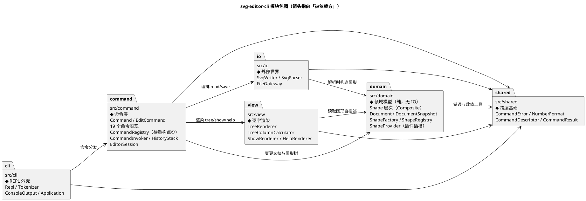
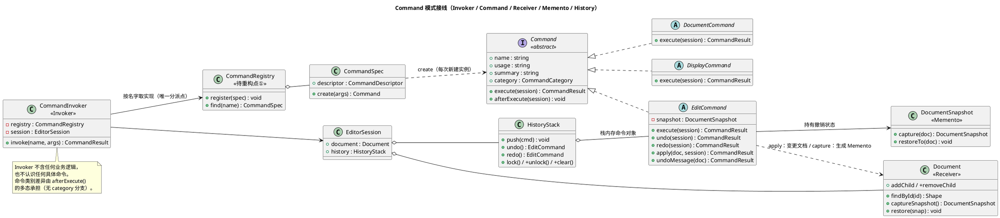
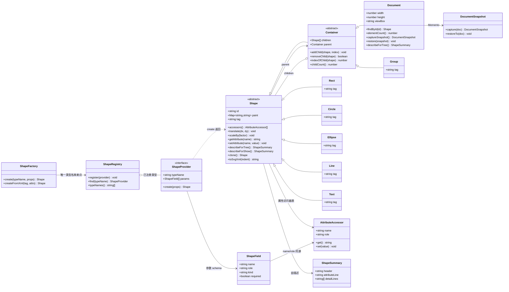
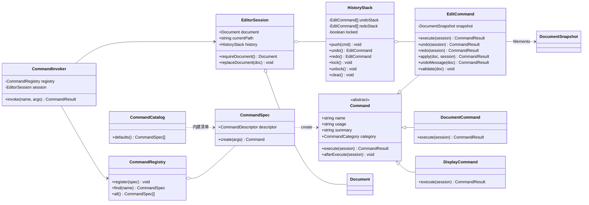
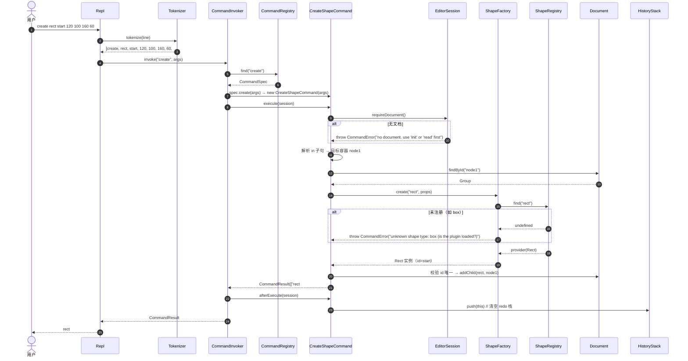

# svg-editor-cli 系统架构设计（Lab1 Phase 1）

> 作者：架构师 高见远 ｜ 状态：**待架构评审** ｜ 版本：v1.0
> 上游文档（唯一权威需求来源）：`E:/高级软开/phase_cli_1.md`（作业规格书）
> 需求裁决来源：`docs/PRD.md`（57 条需求 / 16 条错误文案 E-01~E-16 / 25 条逐字会话契约 T-01~T-25 / tree 对齐规则 §6.1 / 15 条裁决 Q1~Q15）
> 本文档定位：**架构方案 + 施工单**。不含实现代码（仅接口签名与图）。

---

## 0. 摘要（TL;DR）

| 维度 | 结论 |
|---|---|
| 模块数 | **6 个**（`shared` / `domain` / `io` / `view` / `command` / `cli`） |
| 核心设计模式 | **Command（作业硬性要求）** + Memento + Composite + Factory/Provider + Template Method + Registry（后两者为自研轻量实现） |
| 明确不采用 | Visitor / Observer / Iterator / State / Singleton / Builder（理由见 §4.8） |
| 按名字分派 | **仅 2 处**：`CommandRegistry`（命令名→命令）、`ShapeFactory`+`ShapeRegistry`（类型名→实现）。两处均在 §4.9 标注「待重构」并给出重构方向 |
| 文件总数 | **约 81 个**（`src/` 63 + 配置 3 + 文档 3 + 测试 10 + 辅助 2） |
| 任务数 | **5 个**（T01~T05，每任务给出验收对应的 R-xx / T-xx / E-xx 与复杂度） |
| 最大风险 | ① tree 属性列对齐必须逐字（§6.1 规则已演算验证）② 未在 T-xx 中出现的 8 条 undo 回显文案尚无契约（§12 OQ-03）③ `set` 作用于容器的语义未定（§12 OQ-01） |
| 待明确事项 | **20 条**（§12），其中 4 条为 P0 阻塞项 |

---

## 1. 硬约束提炼（设计输入）

架构方案必须同时满足下列硬约束，后续所有设计决策都以此为前提：

| # | 约束 | 出处 | 对架构的直接影响 |
|---|---|---|---|
| C1 | TypeScript + 面向对象：类层次 + 多态 + 字段封装 | 规格 §2.1 / R-80 | 必须有抽象基类与继承层次，不能是数据袋 + 函数 |
| C2 | **一类一文件，文件名 = 类名** | 规格 §2.1 / R-80 | `src/**/Foo.ts` 内只声明 `class Foo`；命令模式直接导致 ~19 个命令类 → 19 个文件 |
| C3 | **禁止贫血模型 + 过程式自由函数 + 到处 `switch(tag)`** | 规格 §2.1 | 几何知识必须留在 `Shape` 层次内；渲染器不得按标签分派 |
| C4 | 按名字分派只允许 2 处，且必须在架构方案中标注「待重构」 | 规格 §2.1 / R-81 | 见 §4.9 |
| C5 | 容器与叶子统一操作（Composite 语义） | 规格 §2.1 / R-34 | `move`/`scale`/`set`/`delete` 对 `<g>` 与叶子同一套接口 |
| C6 | 错误前缀 `error:`、一行一条、**命令失败不改变任何状态** | 规格 §2 / R-04 | 需要"校验先行 + 快照回滚"的双保险机制（§11.8） |
| C7 | 一条编辑命令 = 一个 undo 单元；IO 类命令后禁 undo/redo | 规格 §4.3 / R-41 / R-43 | undo 单元 = 一条 `EditCommand` 对象；历史栈与锁分离（§4.2、§11.6） |
| C8 | tree 属性列对齐 = 全局单列 `col = 2 + max(4×depth + len(tag#id))` | PRD §6.1 / R-51 | 对齐算法独立为一个类（`TreeColumnCalculator`），不散落在渲染器里 |
| C9 | 本阶段**不实现 box**，但必须留插件缝隙 | PRD §2.3 / R-22 / R-85 | 类型注册点必须是 provider 化接口；内核零 box 代码 |
| C10 | 数值回显整数不带 `.0` | PRD Q12 / R-93 | 统一数值格式化入口（`NumberFormat`） |
| C11 | 最终文档在 `doc/README.md`（单数），`docs/` 留过程产物 | PRD Q13 / R-82 | 见 §8.1 目录安排 |
| C12 | TypeScript 严格模式、禁止 `any` 兜底 | 评审期望 | `tsconfig` 开 `strict` |

---

## 2. 实现方案与关键难点

### 2.1 五个真正的难点

| # | 难点 | 为什么难 | 方案（详见对应章节） |
|---|---|---|---|
| D1 | **undo/redo 粒度 + IO 锁** | 20 条命令中只有 11 条可撤销；`group` 一次改 3 个父容器；`ungroup` 要复原插入位置；`front/back` 要复原索引 | Command + Memento：**全量文档快照**作为撤销单元，`EditCommand` 模板方法保证"一条命令一个快照"；锁状态独立于栈（§4.2、§11.6） |
| D2 | **禁止到处 `switch(tag)`** | tree/show 需要知道每个类型的几何属性；序列化需要知道每个类型的 XML 写法 | **几何知识下沉到 `Shape`**：每个类型用「属性访问器表」自描述，基类提供 `translate`/`scaleBy`/`getAttribute` 等泛型算法；`describeForTree()`/`describeForShow()`/`toSvgXml()` 多态自渲染（§11.4） |
| D3 | **统一操作语义（Composite）** | 容器要递归；`set` 在容器上的语义规格未定义 | `Container` 覆写 `translate`/`scaleBy` 递归到子节点；叶子各自实现访问器表（§4.4） |
| D4 | **tree 逐字对齐** | 列宽是**全局单列**，容器不参与计算，且要逐字复现两处示例 | `TreeColumnCalculator` 独立成类，两遍法：先算 `col`，再渲染补空格（§11.5） |
| D5 | **失败原子性** | 多步变更（group 摘出 + 插入；ungroup 提升）中间抛错会留下半成品 | 命令模板方法：**校验 → 捕获快照 → 执行 → 异常回滚快照**（§11.8） |

### 2.2 选型

- **TypeScript 5.x + ESM（`module: NodeNext`）+ 严格模式**：类型系统足以表达"形状层次 + 多态"；ESM 是 Node 官方默认方向；`NodeNext` 保证编译产物可直接被 Node 运行（相对导入强制带 `.js` 后缀，见 §7.5）。
- **唯一运行时依赖 `fast-xml-parser`**：SVG 是 XML，必须有解析器。手写解析器要处理实体、CDATA、命名空间、自闭合，200 行起步且易错；`fast-xml-parser` 零传递依赖、`preserveOrder` 模式能保留**文档顺序**（SVG 绘制顺序 = 文档顺序，R-61 明确要求保留顺序）。
- **测试框架 `vitest`**：与 ESM + TS 零配置（无需 `ts-jest` / Babel）；启动快；断言 API 与 Jest 兼容，工程师易上手。备选 `node:test`（零依赖）作为降级方案，但需要额外的 loader 配置，收益不足。
- **不引入 CLI 框架**（commander/yargs/ink 等）：REPL 只需 readline + 分词；引入框架会与"一类一文件、禁止过程式自由函数"的评审口味冲突，且我们自己实现 `Tokenizer` 更有控制力。

---

## 3. 模块划分

### 3.1 目录级模块清单

| 模块（目录） | 一句话职责 | 层 |
|---|---|---|
| `src/shared/` | 跨层共享的最小基础：异常类型、数值格式化、命令描述符与结果载体 | 基础层 |
| `src/domain/` | 纯领域模型：形状层次（Composite）、文档、形状工厂与类型注册表、撤销快照 | 领域层 |
| `src/io/` | 与外部世界打交道：SVG 序列化 / 反序列化、文件读写网关 | 基础设施层 |
| `src/view/` | 把领域对象渲染成**逐字确定**的文本：tree / show / help | 表现层 |
| `src/command/` | Command 模式宿主：命令抽象与 19 个实现、命令注册表、Invoker、历史栈、会话状态 | 应用层 |
| `src/cli/` | REPL 外壳：读行、分词、控制台输出、依赖装配与启动 | 交互层 |

### 3.2 模块包图（PlantUML）



### 3.3 模块职责详表

#### `src/shared/`（4 文件）
| 文件 | 职责 |
|---|---|
| `CommandError.ts` | 承载**用户可见错误消息**的异常类型（消息不含 `error: ` 前缀，前缀由 CLI 统一加） |
| `NumberFormat.ts` | 唯一的数值 → 字符串出口（整数不带 `.0`、浮点去噪、R-93） |
| `CommandDescriptor.ts` | 命令的**纯数据描述**（name / usage / summary / category），供 `help` 渲染且不引入对命令类的依赖 |
| `CommandResult.ts` | 命令返回值载体（多行输出 + 警告行），避免命令直接写 stdout |

#### `src/domain/`（16 文件）
| 文件 | 职责 |
|---|---|
| `Shape.ts` | 形状抽象基类：id、paint（fill/stroke/stroke-width）、属性访问器表、**泛型** `translate`/`scaleBy`/`getAttribute`/`setAttribute`、抽象 `describeForTree`/`describeForShow`/`toSvgXml`/`clone` |
| `Container.ts` | 容器抽象基类：子节点集合、`addChild`/`removeChild`/`indexOfChild`，并**覆写** `translate`/`scaleBy` 为递归（Composite 语义的落点） |
| `Group.ts` | `<g>` 容器（tag `g`），是本阶段唯一的用户可见容器类型 |
| `Rect.ts` / `Circle.ts` / `Ellipse.ts` / `Line.ts` / `Text.ts` | 五种叶子图形：各自声明参数 schema（静态）与属性访问器（实例），几何知识**只**存在于这 5 个文件内 |
| `Document.ts` | 当前文档：根容器（即 `<svg>`）+ 画布尺寸 + id 索引 + 元素计数 + 快照/恢复 |
| `ShapeProvider.ts` | **插件插槽接口**：类型名 + 参数 schema + `create(props)`；内建类型以"类自身静态成员"满足该接口，插件类型以 `implements ShapeProvider` 的类满足 |
| `ShapeRegistry.ts` | 类型注册表：`register(provider)` / `find(typeName)` / `typeNames()` |
| `ShapeFactory.ts` | **待重构点②**：类型名 → 实例的唯一映射入口；同时提供"按 XML 标签构造"的入口供解析器使用 |
| `ShapeField.ts` | 参数 schema 值对象：`name` / `role`（position·size·content·paint）/ `kind`（number·color·string）/ `required` |
| `AttributeAccessor.ts` | 属性访问器值对象：`name` / `role` / `get()` / `set(v)`，是「多态取代 switch(tag)」的关键零件 |
| `ShapeSummary.ts` | 形状的自描述结果：header / attributeLine（tree 属性行）/ detailLines（show 明细行） |
| `DocumentSnapshot.ts` | **Memento**：文档的不可变深拷贝，`capture(document)` / `restoreTo(document)` |

#### `src/io/`（4 文件）
| 文件 | 职责 |
|---|---|
| `SvgWriter.ts` | 文档 → SVG 文本：XML 声明 + 根元素 + 子元素（逐字符合 R-60） |
| `SvgParser.ts` | SVG 文本 → 文档：解析元素顺序、层级、id、几何、paint、text 内容；缺 id 自动补齐并产出告警 |
| `SvgParseResult.ts` | 解析结果载体：文档 + 告警行列表（`warning: assigned id rect1 to unnamed <rect>`） |
| `FileGateway.ts` | 文件读写网关：读文本 / 写文本；失败抛 `CommandError`（E-10 / E-11） |

#### `src/view/`（4 文件）
| 文件 | 职责 |
|---|---|
| `TreeRenderer.ts` | 文档 → tree 文本：遍历、树形字符、首行 `svg (W×H)`、调用列对齐器补空格 |
| `TreeColumnCalculator.ts` | **C8 规则的唯一实现**：两遍法计算全局 `col` 与每行补空格数 |
| `ShowRenderer.ts` | 图形 → show 明细三行（`tag#id  parent=…` + 缩进 2 空格的属性行） |
| `HelpRenderer.ts` | 命令描述符列表 → help 文本（Q10 格式），**只依赖 `shared` 的描述符接口**，不依赖命令实现 |

#### `src/command/`（29 文件）
| 文件 | 职责 |
|---|---|
| `Command.ts` | 命令抽象基类：`name` / `usage` / `summary` / `category` / `execute()` / `afterExecute()` |
| `EditCommand.ts` | 编辑类命令基类：模板方法 `execute()`（校验→快照→apply→异常回滚）、`undo()` / `redo()` |
| `DocumentCommand.ts` | 文档类命令基类：执行后锁死 undo/redo |
| `DisplayCommand.ts` | 显示类命令基类：不产生 undo 单元 |
| `CommandSpec.ts` | 命令的注册单元：描述符 + `create(args)` 工厂（命令对象**有状态**，必须每次新建实例） |
| `CommandRegistry.ts` | **待重构点①**：命令名 → `CommandSpec` 的注册表 |
| `CommandCatalog.ts` | 19 个内建命令的 `CommandSpec` 清单（内建注册的唯一清单文件） |
| `CommandInvoker.ts` | **Invoker**：解析命令名 → 取 spec → 建实例 → `execute` → `afterExecute`（历史栈与 IO 锁的编排点） |
| `HistoryStack.ts` | undo 栈 / redo 栈 / IO 锁；一条命令一个单元的物理载体 |
| `EditorSession.ts` | 会话状态：当前文档、当前文件路径、`HistoryStack`、文档替换入口 |
| `commands/`（19 个） | 19 个命令实现，**一类一文件**，见 §9.5 命令清单速查表 |

#### `src/cli/`（5 文件 + 入口）
| 文件 | 职责 |
|---|---|
| `Repl.ts` | REPL 主循环：打印横幅、提示符 `svg> `、逐行读入、注释/空行过滤、EOF 退出、错误呈现 |
| `Tokenizer.ts` | 行 → token 列表：空白切分 + 双引号包裹（保留"是否加引号"标记） |
| `Token.ts` | token 值对象：`value` / `quoted` |
| `ConsoleOutput.ts` | stdout 写入端口（便于测试替换） |
| `Application.ts` | 组合根：装配 Registry / Session / Invoker / Repl（唯一允许"new 具体类"的地方） |
| `src/index.ts` | 进程入口：调用 `Application` 启动 |

---

## 4. 设计模式的选择与落地

### 4.1 模式清单总表

| 模式 | 必选/自选 | 落地位置（类 → 文件） | 一句话理由 |
|---|---|---|---|
| **Command** | **必选（作业硬性要求）** | `Command` / `EditCommand` / `DocumentCommand` / `DisplayCommand` + 19 个具体命令 → `src/command/**` | undo/redo 的天然载体；命令是对象而非字符串分支 |
| **Memento** | 自选（与 Command 配套） | `DocumentSnapshot` → `src/domain/DocumentSnapshot.ts` | 撤销单元用快照承载，避免 19 份手写逆操作 |
| **Composite** | 自选（规格要求） | `Shape` / `Container` / `Group` → `src/domain/Shape.ts`、`Container.ts`、`Group.ts` | 容器与叶子统一操作接口 |
| **Factory / Provider** | 自选（承载插件缝隙） | `ShapeFactory` / `ShapeRegistry` / `ShapeProvider` → `src/domain/**` | 类型名 → 实现；未来 `box` 插件零内核改动 |
| **Template Method** | 自选 | `EditCommand.execute()` → `src/command/EditCommand.ts` | 统一"校验→快照→执行→回滚"骨架，子类只写业务 |
| **Registry（自研轻量）** | 自选 | `CommandRegistry`、`ShapeRegistry` | 把"按名字分派"从 switch 收敛到唯一可替换的数据结构 |
| Builder | 不采用 | — | `create` 是固定位置参数，schema 表驱动更简单（§4.8） |
| Visitor | 不采用 | — | 会把几何知识搬出 `Shape`，形成"两份知识"（§4.8） |
| Observer | 不采用 | — | 无多方订阅需求（§4.8） |
| Iterator | 不采用 | — | 子节点集合用数组 + 只读视图即可（§4.8） |
| State | 不采用 | — | 命令差异用类层次表达，而非运行时状态切换（§4.8） |
| Singleton | 不采用 | — | 全局状态会让测试与 undo 语义失控（§4.8） |

### 4.2 Command 模式（作业硬性要求）

#### 4.2.1 三个角色的对应关系（GoF 角色 → 本项目）

| GoF 角色 | 本项目 | 位置 | 说明 |
|---|---|---|---|
| **Invoker** | `CommandInvoker` | `src/command/CommandInvoker.ts` | 接收"命令名 + 参数"，从注册表取 `CommandSpec` → 新建命令对象 → `execute()` → `afterExecute()`（维护历史栈与 IO 锁）。它**不包含任何业务逻辑**，也不认识任何具体命令 |
| **Command** | `Command`（抽象基类）+ 19 个具体命令 | `src/command/Command.ts`、`src/command/commands/**` | 每个命令对象封装：① 自己的参数（构造注入）② **执行逻辑** ③ **撤销逻辑**（编辑类）。命令对象**有状态且不可复用**，每次执行新建实例 |
| **Receiver** | `Document`（及其 `Shape` 树） | `src/domain/Document.ts`、`src/domain/Shape.ts` | 真正被操作的领域对象。命令通过 `session.requireDocument()` 拿到它，对其做 `addChild` / `removeChild` / 属性变更等**领域动作**，自己不碰 XML 与文件 |
| （配套）**Memento** | `DocumentSnapshot` | `src/domain/DocumentSnapshot.ts` | 由 Receiver 创建（`Document.captureSnapshot()`），交给 Command 保管，用于撤销 |
| （配套）**History** | `HistoryStack` | `src/command/HistoryStack.ts` | Invoker 的协作者：存放已执行的 `EditCommand`（命令对象自带 Memento） |

> 关键点：**历史栈里存的是命令对象，不是快照**。快照只是命令对象的私有字段（`_snapshot`）。这样 undo 时能同时拿到"状态（Memento）"和"文案生成逻辑（命令自己知道怎么写回显）"。

#### 4.2.1.1 Command 模式接线图（PlantUML）



#### 4.2.2 命令接口与撤销机制

```ts
// src/command/Command.ts
abstract class Command {
  abstract readonly name: string;        // 'create'
  abstract readonly usage: string;       // 'create <type> <id> [params…] [in <containerId>]'
  abstract readonly summary: string;     // help 用的一行说明
  abstract readonly category: CommandCategory; // 'edit' | 'document' | 'display'
  abstract execute(session: EditorSession): CommandResult;
  afterExecute(session: EditorSession): void { /* 默认空 */ }
}

// src/command/EditCommand.ts
abstract class EditCommand extends Command {
  private snapshot: DocumentSnapshot | null = null;

  final execute(session: EditorSession): CommandResult {
    const doc = session.requireDocument();          // 无文档 → E-12
    this.validate(doc);                             // 子类实现：只读校验，不改状态
    const before = DocumentSnapshot.capture(doc);    // Memento
    try {
      const result = this.apply(doc, session);       // 子类实现：真正的变更
      this.snapshot = before;
      return result;
    } catch (err) {
      before.restoreTo(doc);                        // 原子性兜底：异常即回滚
      throw err;
    }
  }

  undo(session: EditorSession): CommandResult { /* 用 snapshot 恢复 + 生成 undo 文案 */ }
  redo(session: EditorSession): CommandResult { /* 再次 apply，天然产出与首次完全相同的文案 */ }
  protected abstract apply(doc: Document, session: EditorSession): CommandResult;
  protected abstract undoMessage(doc: Document): CommandResult;
}
```

#### 4.2.3 "一条命令 = 一个 undo 单元"的实现机制

1. 一条用户输入 → 一个 `CommandSpec` → **一个命令实例** → 一次 `execute()` → 一次 `DocumentSnapshot.capture()` → **一个 `EditCommand` 入栈**。
2. `group markers c1 box` 改了 3 个父容器，但它仍是**一个命令实例、一份快照、一个栈单元** → `undo` 一次全还原（满足 R-41）。
3. `HistoryStack.push()` 同时**清空 redo 栈**（满足 R-40："undo 后若有新编辑，redo 栈清空"）。
4. `redo` = 再次 `apply()`（而不是"恢复快照后再执行"），因此回显**天然与首次执行完全相同**（满足 R-45）。
5. **undo 文案**由命令自己生成：`undoMessage(doc)` 在快照恢复后读取文档状态反推（如 move 的旧坐标、delete 的旧父容器、set 的旧值），保证文案与状态一致，不会出现"状态回滚了但文案是硬编码"的错位。

#### 4.2.4 为什么用"全量快照"而不是"手写逆操作"

手写逆操作（GoF 原味 Command）在 19 个命令上会产生这些易错点：

| 命令 | 手写逆操作的坑 |
|---|---|
| `group` | 需复原每个成员的**原父容器 + 原索引**；成员可能来自不同父容器 |
| `ungroup` | 需复原容器在父级中的**插入位置**（不是简单追加到末尾） |
| `front`/`back` | 需复原同级**原索引** |
| `addto` | 需复原原父容器 + 原索引 |
| `scale` | 容器语义下要复原**全部子孙**的几何值 |

快照法把"逆操作"交给"状态还原"，**一条规则覆盖所有命令**，且天然满足 C6（失败原子性）。代价是 O(文档规模) 的复制与内存占用——对交互式 CLI（文档规模 10²~10³ 元素）完全可接受。若未来文档变大，`DocumentSnapshot` 可拆成"按节点 id 的差量 Memento"，接口不变（§6 变化点 V-08）。

#### 4.2.5 命令分派（**待重构点①**，详见 §4.9）

- 分派点唯一：`CommandRegistry.find(name)`。
- 每个命令类通过 `CommandSpec` 自带 `name` / `usage` / `summary` / `category`（**命令对象自身提供**，而非外部维护一张对照表）。
- `CommandCatalog` 是内建命令的唯一清单（19 行注册语句），新增命令 = 加一个类 + 加一行注册。

### 4.3 Memento 模式

| 项 | 内容 |
|---|---|
| 落地 | `DocumentSnapshot`（`src/domain/DocumentSnapshot.ts`） |
| 职责 | 捕获文档的不可变深拷贝；`restoreTo(doc)` 把文档状态还原 |
| 创建者 | Receiver（`Document.captureSnapshot()` / `Document.restore(snapshot)`） |
| 保管者 | `EditCommand._snapshot` |
| 为何需要"不透明" | `DocumentSnapshot` 对命令层只暴露 `capture` / `restoreTo` 两个静态入口，内部结构（克隆策略）不外泄，符合 GoF Memento 的封装意图 |
| 与 undo 单元的关系 | 一份 Memento = 一个 undo 单元 |

### 4.4 Composite 模式

| 项 | 内容 |
|---|---|
| Component | `Shape`（抽象基类）：统一接口 `translate(dx,dy)` / `scaleBy(factor)` / `setAttribute(name,value)` / `getAttribute(name)` / `describeForTree()` / `describeForShow()` / `toSvgXml()` / `clone()` |
| Composite | `Container`（抽象）：持有 `children`；**覆写** `translate`/`scaleBy` 为「对每个子节点递归调用同名方法」 |
| Concrete Composite | `Group`（`<g>`）、`Document`（根容器即 `<svg>`） |
| Concrete Leaf | `Rect` / `Circle` / `Ellipse` / `Line` / `Text` |
| Composite 语义落地 | ① `move` 对容器 = 递归平移所有子孙；② `scale` 对容器 = 递归把**每个子孙各自的**几何属性乘以 factor（绝对坐标，非"相对组原点"）；③ `delete` 对容器 = 连带子孙（由 `Document` 摘除子树实现，位置信息由父容器索引提供） |
| 边界说明 | `set` 在容器上的语义规格未定义（R-27 白名单允许 fill，但 §4.4 把"传播语义"划归插件）→ 见 §12 OQ-01，架构上预留为 `Container` 可覆写点 |

### 4.5 Factory / Provider 模式（承载 C9 插件缝隙）

| 项 | 内容 |
|---|---|
| `ShapeProvider`（接口，`src/domain/ShapeProvider.ts`） | `typeName` + `params`（参数 schema）+ `create(props)`。**这就是未来 `box` 插件要实现的接口** |
| `ShapeRegistry` | 类型注册表：`register(provider)` / `find(typeName)` / `typeNames()` |
| `ShapeFactory` | **唯一的"类型名 → 实现"映射点**：`create(typeName, props)`；未注册 → 抛 `CommandError('unknown shape type: ' + typeName + ' (is the plugin loaded?)')`（E-05 逐字） |
| 内建类型的注册形态 | **不额外写 Provider 类**：每个形状类的**静态成员**（`static readonly typeName` / `static readonly params` / `static create(props)`）在结构上满足 `ShapeProvider` 接口，因此 `registry.register(Rect)` 合法。内建 6 型 = 6 个注册语句，不产生额外文件 |
| 插件接入路径（未来阶段，本阶段**不实现**） | 新增 `class BoxShapeProvider implements ShapeProvider` → `registry.register(new BoxShapeProvider())`；`create` 命令因参数 schema 驱动而**无需改动**；tree/show 因多态自描述而自动支持 |
| 本阶段的"空插槽"体现 | ① `ShapeProvider` 接口存在但**无任何外部实现**；② `ShapeRegistry.register()` 是 public；③ `ShapeFactory` 对未注册类型走 E-05 逐字错误（含 `(is the plugin loaded?)` 提示）；④ **代码中不出现 box / data-kind / rect+text 模板等任何字样**（C9 / R-85） |

### 4.6 Template Method 模式

| 项 | 内容 |
|---|---|
| 落地 | `EditCommand.execute()`（`src/command/EditCommand.ts`）：`validate → capture → apply → (异常)restore`，`apply` 与 `undoMessage` 为抽象钩子 |
| 收益 | 19 个编辑命令共享"原子性 + 快照 + undo 单元"三条不变量；子类无法忘记回滚 |
| 同类 | `Command.afterExecute()` 也是模板（基类默认空，子类按类别覆写：编辑类 → 入栈；文档类 → 上锁） |

### 4.7 Registry（自研轻量，非 GoF 正式模式）

| 项 | 内容 |
|---|---|
| 落地 | `CommandRegistry`（命令名 → `CommandSpec`）、`ShapeRegistry`（类型名 → `ShapeProvider`） |
| 为什么不是 switch | `switch(name)` 会让"新增命令 = 改一个中央函数"，且违反 C3 的精神；注册表把"新增"降级为"新增一行"，且可被**外部插件**在运行时扩展（`register` 是 public） |
| 与 C4 的关系 | 这两处是**唯一允许**的按名字分派，已在 §4.9 标注待重构 |

### 4.8 其它可选模式的取舍（本阶段不做）

| 场景 | 备选模式 | 决定 | 理由 |
|---|---|---|---|
| 撤销状态 | 逆操作 / Memento | **Memento** | §4.2.4 |
| 遍历 tree | Visitor | **不用 Visitor** | Visitor 会要求 `Shape` 把几何知识交出去（`visitRect(Rect)` 之类），导致"几何知识在 Shape"与"几何知识在 Visitor"两份真相，且序列化/树形/show 三种遍历各写一份 Visitor → 反而制造新的分派点。改为 `Shape` 自描述（§11.4） |
| 状态变化通知 | Observer | **不用** | 无订阅者需求；`tree`/`show` 是显式调用而非订阅。若未来接 GUI，REPL 的输出端口（`ConsoleOutput`）即为通知点，届时再引入不迟 |
| 子节点遍历 | Iterator | **不用** | 子节点集合就是数组，暴露 `readonly Shape[]` 只读视图已足够；引入 Iterator 增加理解成本 |
| 命令类别差异 | State | **不用** | 用类层次（`EditCommand`/`DocumentCommand`/`DisplayCommand`）表达，比运行时状态切换更易读、更易测 |
| 全局访问 | Singleton | **不用** | `EditorSession` 由组合根装配并注入，全局单例会破坏可测性与 undo 语义 |
| `create` 参数装配 | Builder | **不用** | 参数是固定位置序，schema 表驱动比 Builder 链更短也更易读 |

### 4.9 C4 的两处「按名字分派」——**待重构标注**（R-81 强制项）

| # | 待重构点 | 位置 | 现状 | 问题 | 重构方向（后续阶段） |
|---|---|---|---|---|---|
| ① | **命令分发**（命令名 → 命令实现） | `src/command/CommandRegistry.ts` + `src/command/CommandCatalog.ts` | 已是注册表（`Map`）而非 `switch`，命令对象自带 `name`/`usage`/`summary`/`category`；但 `CommandCatalog` 仍是**中心清单**，且 `CommandSpec.create` 闭包把参数解析耦合在注册处 | 新增命令仍需改中心清单；插件无法自注册命令 | ① 命令的**参数解析下沉到命令类**（`Command.parse(tokens)` 自解析），`CommandSpec` 只剩元数据；② 引入 `CommandProvider` 概念，插件可 `registry.register(provider)` 自带命令；③ 长期形态：注册表由**能力声明**驱动（每条命令声明自己的参数 schema，Invoker 统一解析与报错），彻底消除中心清单 |
| ② | **图形工厂**（类型名 → 类） | `src/domain/ShapeFactory.ts` + `src/domain/ShapeRegistry.ts` | 已是 provider 化的注册表；内建类型以"类静态成员"满足 `ShapeProvider`；未注册类型抛 E-05 逐字错误 | 内建类型与插件类型在注册方式上不完全同构；`ShapeFactory` 仍同时承担"CLI 创建"与"XML 反序列化"两条路径的入口 | ① 把"从 XML 属性构造"也纳入 `ShapeProvider`（`fromXml`），使 `SvgParser` 也只依赖接口；② 内建类型也各写一个 `XxxShapeProvider` 类（与插件完全同构，代价 +6 文件）；③ 长期形态：`ShapeProvider` 增加"复合图形能力"声明（子部件模板、`set` 传播策略、序列化标记），即规格 §4.4 的插件化目标 |

> 上述两点将在 `doc/README.md` 的「架构方案」节中**原样复述**（R-81 要求显式标注）。

---

## 5. 依赖方向规则

### 5.1 允许的依赖（逐条 + 理由）

| # | 允许 | 理由 |
|---|---|---|
| A1 | `shared` ← 其它任何模块 | 基础层零依赖（只含异常、数值格式化、纯数据描述符），是依赖图的汇点 |
| A2 | `domain` → `shared` | 领域层需要 `CommandError` 抛业务错误、需要 `NumberFormat` 统一数值口径 |
| A3 | `io` → `domain` | 解析器必须**构造领域对象**（矩形、组等），序列化器必须**读取领域对象**；方向只能是 io → domain，反向会污染领域模型 |
| A4 | `io` → `shared` | 需要 `CommandError`（E-10/E-11）与 `NumberFormat` |
| A5 | `view` → `domain` | 渲染器读取形状自描述（`describeForTree`/`describeForShow`）与文档结构 |
| A6 | `view` → `shared` | 需要 `NumberFormat`（属性行里的数值格式）与 `CommandDescriptor`（help 渲染，避免 view → command 形成环） |
| A7 | `command` → `domain` | 命令的 Receiver 就是文档与图形树 |
| A8 | `command` → `io` | `read`/`save` 是命令，必须编排文件与 SVG 转换；**io 不反向依赖 command**，故无环 |
| A9 | `command` → `view` | `tree`/`show`/`help` 是命令，产出文本由 view 渲染（保证渲染逻辑只有一份，命令不重复实现格式） |
| A10 | `command` → `shared` | 异常、结果载体、描述符 |
| A11 | `cli` → `command` | REPL 只做"读行 → 分词 → 交给 Invoker → 打印结果"，不认识任何具体命令 |
| A12 | `cli` → `shared` | 需要 `CommandError`（统一加 `error: ` 前缀）与 `CommandResult`（多行输出） |

### 5.2 禁止的依赖（逐条 + 理由）

| # | 禁止 | 理由 / 一旦违反的后果 |
|---|---|---|
| F1 | `domain` → `io` / `cli` / `command` / `view` | 领域模型必须可脱离终端与文件系统被测试；一旦反向依赖，undo 快照与几何逻辑无法单测 |
| F2 | `domain` → `view` | 领域层不应知道"怎么被打印"；否则 `describeForTree` 会反向污染模型 |
| F3 | `command` → `cli` | 命令层不得直接读写 stdout/提示符；否则命令无法在测试中被断言（违反 C6 可断言性） |
| F4 | `view` → `command` / `io` | view 只做"领域对象 → 文本"；若 view 依赖命令层，`help` 渲染会与命令实现耦合，且与 A9 形成环 |
| F5 | `io` → `command` / `view` | IO 只负责"字节 ↔ 领域对象"，不负责输出格式与命令语义 |
| F6 | `view` ↔ `io` | 互不相干：一者读模型，一者读写文件 |
| F7 | 任何模块 → 另一个模块的**具体实现**（只允许依赖其公开接口） | 避免实现细节外泄，保证可替换（如 `FileGateway` 可换内存实现做测试） |
| F8 | 任何模块 → **全局单例 / 全局可变状态** | undo 需要"可回滚的会话状态"，全局状态会让快照语义失效 |
| F9 | `domain` / `view` → 任何 **IO API**（fs / process / readline） | 同 F1/F2 |
| F10 | 任何模块内的 **`switch(tag)` 分派**（除 §4.9 两处注册表内的名字查找） | 违反 C3 / R-80 / R-81 |

### 5.3 依赖矩阵

行 = 依赖方，列 = 被依赖方；`✔` 允许、`✘` 禁止、`—` 自身。

| 依赖方 ＼ 被依赖 | `shared` | `domain` | `io` | `view` | `command` | `cli` |
|---|:--:|:--:|:--:|:--:|:--:|:--:|
| `shared`   | — | ✘ | ✘ | ✘ | ✘ | ✘ |
| `domain`  | ✔ | — | ✘ | ✘ | ✘ | ✘ |
| `io`      | ✔ | ✔ | — | ✘ | ✘ | ✘ |
| `view`    | ✔ | ✔ | ✘ | — | ✘ | ✘ |
| `command` | ✔ | ✔ | ✔ | ✔ | — | ✘ |
| `cli`     | ✔ | ✘ | ✘ | ✘ | ✔ | — |

> 矩阵是无环的：`shared ← domain ← io`、`shared ← domain ← view`、`command ← {domain, io, view}`、`cli ← command`。

### 5.4 违规的可检查手段（写进"一致性自查"）

1. **脚本检查**：`scripts/check-deps.mjs`（P1）扫描 `src/**` 的 `import` 语句，按 §5.3 矩阵校验，违规则退出码非 0 → 可挂到 `npm run check:deps`。
2. **人工抽样**：在 `doc/README.md` 的「一致性自查」节贴出抽样结果（至少各抽 2 个文件）。
3. **禁用项检查**：`grep -rn "switch *(" src/` 的结果必须只出现在 `CommandRegistry` / `ShapeRegistry` / `ShapeFactory` 的名字查找处（R-81 允许的两处）；命令类别差异已由 `afterExecute` 多态消除（§4.6），因此**不应**出现 category 的 switch。

---

## 6. 变化点假设

| # | 未来最可能变化的地方 | 影响面 | **我为它留了什么** | 现在不做的理由 |
|---|---|---|---|---|
| V-01 | **新增图形类型**（规格 §4.4 的 `box` 复合图形、后续插件） | `create` 参数解析、tree/show 渲染、序列化 | ① `ShapeProvider` 接口 + `ShapeRegistry.register()` 为公开注册点；② `create` 命令**完全由 schema 驱动**（不 switch 类型），新类型零改动接入；③ tree/show 靠 `Shape` 多态自描述，新类型自动被支持；④ 未注册类型走 E-05 逐字错误并自带 `(is the plugin loaded?)` 提示 | 本阶段**禁止**出现任何 box 实现代码（C9 / R-85）。`ShapeProvider` 只是通用插槽，不含 rect+text 模板、`data-kind`、传播语义等任何 box 专属信息 |
| V-02 | **新增命令** | 命令注册、help 文本 | `CommandSpec` 自带 name/usage/summary/category；`CommandCatalog` 单点登记；help 从描述符列表自动生成 | 无 |
| V-03 | **撤销粒度变化**（跨 IO 历史回退、批量合并撤销） | `HistoryStack` 语义 | 锁（`lock/unlock`）与栈（`push/undo/redo/clear`）分离；R-43 的"IO 后禁 undo"只是 `HistoryStack.lock()` 的一行策略 | PRD 明确禁止跨 IO 回退（Out of Scope ⑤） |
| V-04 | **画布坐标系 / viewBox 缩放策略**（R-15 裁决为"不缩放"） | `Document` 的 width/height/viewBox | 尺寸集中在 `Document`；`viewBox` 作为 `Document` 的一个字段而不是散落在序列化器里 | R-15 已裁决不缩放，无需预留分支 |
| V-05 | **输出格式变化**（tree 列对齐规则、show 明细、help 版式） | 所有显示类输出 | 全部集中在 `src/view/`；列对齐规则独立成 `TreeColumnCalculator`，改规则只动一个类 | 无 |
| V-06 | **SVG 序列化细节**（属性顺序、转义、缩进、XML 声明） | 产出文件 | 每个 `Shape.toSvgXml(indent)` 自渲染自己；`SvgWriter` 只负责根元素与声明 | 无 |
| V-07 | **交互形态变化**（脚本回放 / 批量文件 / GUI） | CLI 层 | `ConsoleOutput` 是输出端口；`Tokenizer` 与 `Repl` 分离；脚本回放只需"逐行喂 Token"，GUI 只需替换输出端口与输入源 | R-95 明确本阶段不实现（P2） |
| V-08 | **文档规模变大 → 快照成本上升** | `DocumentSnapshot` | `DocumentSnapshot` 是**类**而非散落逻辑；若需差量 Memento，只需替换其内部实现，`EditCommand` 不动 | 当前规模（10²~10³ 元素）下全量快照成本可忽略 |
| V-09 | **错误文案体系化**（错误码 → 文案表） | 全局 | 所有错误以 `CommandError(message)` 抛出，**消息文本集中在抛出点**；测试直接断言字符串 | 现阶段 16 条错误文案逐字固定，抽成表反而增加跳转成本；如需国际化再抽 `MessageCatalog` |
| V-10 | **多文档 / 多标签页** | `EditorSession` | 会话持有"当前文档"引用而非全局变量；换文档 = 替换引用 | PRD 明确单文档（Out of Scope ⑥） |
| V-11 | **结构路径寻址**（`/canvas/g1/rect[2]`） | 定位方式 | 所有命令统一经 `Document.findById(id)` 定位；未来可插入 `ShapeResolver` 接口而不改命令 | PRD 明确 Out of Scope ③；id 寻址已足够 |
| V-12 | **`set` 在容器上的传播语义** | `Container` | `Container` 是 `setAttribute` 的覆写点，插件可在自己的 Composite 形状里定义传播 | 规格未定义普通 `<g>` 的语义（§12 OQ-01），故保持"存到容器自身"的最保守实现 |

---

## 7. 技术选型与工程配置

### 7.1 TypeScript 与模块系统

| 项 | 选择 | 理由 |
|---|---|---|
| 语言 | TypeScript `^5.6`，`strict: true` | 满足 C1/C12；`strict` 下禁 `any` 兜底，防止"用类型断言掩盖设计问题" |
| 模块系统 | **ESM**（`package.json` 的 `"type": "module"`） | Node 官方默认方向；`tsx` 可直接跑 TS 源码 |
| 模块解析 | `module: "NodeNext"` / `moduleResolution: "NodeNext"` | 编译产物可被纯 Node 直接运行（`npm start`），且强制相对导入写明 `.js` 后缀 → 消除"ESM 下路径不带扩展名"的经典坑 |
| 目标 | `target: "ES2022"`，`lib: ["ES2022"]`，`types: ["node"]` | Node ≥ 18 原生支持；`readline/promises` 可用 |
| 源码目录 | `src/`，编译产物 `dist/`（`rootDir: src` / `outDir: dist`） | 常规布局 |
| 严格选项 | 额外开 `noImplicitOverride`、`noFallthroughCasesInSwitch`、`forceConsistentCasingInFileNames` | `noImplicitOverride` 强化多态契约；`noFallthroughCasesInSwitch` 与 C3 呼应 |
| 禁止 | `any`、`as unknown as` 逃逸（除非注释说明理由） | R-80 评审观感 |

### 7.2 测试框架选型

| 候选 | 结论 | 理由 |
|---|---|---|
| **vitest** `^2.1` | **选用** | ESM + TS 零配置（内置 esbuild 转换）；启动快；`describe/it/expect` 与 Jest 同构，工程师无需学新 API；支持覆盖率与并行 |
| jest + ts-jest | 不选 | ESM 需额外配置（`extensionsToTreatAsEsm` / `--experimental-vm-modules`），配置摩擦大 |
| `node:test` | 备选（零依赖降级方案） | 需要 loader 才能跑 TS；断言能力弱于 vitest（无内置 mock/快照） |
| 覆盖率 | `vitest --coverage`（`@vitest/coverage-v8`） | 写进 `doc/README.md` 的「质量保证手段」 |

### 7.3 npm scripts

| script | 命令 | 用途 |
|---|---|---|
| `cli` | `tsx src/index.ts` | **规格要求**：`npm run cli` 直接启动 REPL（无需预编译） |
| `build` | `tsc -p tsconfig.json` | 产出 `dist/`（ESM） |
| `start` | `node dist/index.js` | 以编译产物启动 |
| `test` | `vitest run` | 全量回归（逐字契约测试） |
| `test:watch` | `vitest` | 开发态监听 |
| `typecheck` | `tsc --noEmit` | 仅类型检查（提交前必跑） |
| `check:deps` | `node scripts/check-deps.mjs` | 依赖方向自检（P1，可延后） |

### 7.4 package.json 依赖清单（尽量少依赖）

```jsonc
{
  "name": "svg-editor-cli",
  "version": "0.1.0",
  "type": "module",
  "engines": { "node": ">=18.17" },
  "bin": { "svg-editor": "dist/index.js" },
  "scripts": {
    "cli": "tsx src/index.ts",
    "build": "tsc -p tsconfig.json",
    "start": "node dist/index.js",
    "test": "vitest run",
    "test:watch": "vitest",
    "typecheck": "tsc --noEmit",
    "check:deps": "node scripts/check-deps.mjs"
  },
  "dependencies": {
    "fast-xml-parser": "^4.5.0"          // 唯一运行时依赖：SVG/XML 解析
  },
  "devDependencies": {
    "@types/node": "^22.7.0",
    "tsx": "^4.19.0",                     // TS 直跑（npm run cli）
    "typescript": "^5.6.0",
    "vitest": "^2.1.0"
  }
}
```

> 运行时依赖仅 1 个；`typescript` / `tsx` / `vitest` / `@types/node` 均为开发期依赖，不进产物。

### 7.5 目录与命名约定

| 约定 | 规则 |
|---|---|
| 一类一文件 | `src/**/<ClassName>.ts`，文件内只声明该类（可另导出**类型别名 / 常量**，但不得再声明第二个类） |
| 类名 | PascalCase，与文件名完全一致 |
| 方法/参数 | camelCase；布尔量用 `is` / `has` 前缀 |
| 私有字段 | TS `private`，camelCase；命令的撤销快照字段命名 `_snapshot`（体现"内部状态"） |
| 静态常量 | shared 中的常量用 `UPPER_SNAKE_CASE`（如 `DEFAULT_CANVAS_WIDTH = 800`） |
| 相对导入 | **必须带 `.js` 后缀**（NodeNext 约束），如 `import { Shape } from './Shape.js'` |
| 模块目录 | 仅 6 个：`shared` / `domain` / `io` / `view` / `command` / `cli`；命令实现放 `src/command/commands/` |
| 文档目录 | 最终提交物 `doc/README.md`；`docs/` 保存过程产物（`PRD.md`、`ARCHITECTURE.md`） |

---

## 8. 完整文件清单

> 优先级：**P0** = 必须有（缺失即功能不完整）；**P1** = 应该有，可延后（延后须在 README「一致性自查」记录原因）；**P2** = 本阶段明确不做（仅在架构方案说明留了什么缝）。

### 8.1 根目录与文档（7 文件）

| 路径 | 职责 | 优先级 | 模块 |
|---|---|:--:|---|
| `package.json` | 包元信息、依赖清单、npm scripts | P0 | 工程 |
| `tsconfig.json` | TS 编译配置（ESM/NodeNext/ES2022/strict） | P0 | 工程 |
| `.gitignore` | 忽略 `node_modules/`、`dist/`、coverage | P0 | 工程 |
| `doc/README.md` | **最终提交文档**：架构方案（模块划分 + 图 / 设计模式 / 依赖方向 / 变化点）+ 过程记录 + 一致性自查 + 质量保证手段（R-82） | P0 | 文档 |
| `docs/PRD.md` | 过程产物：已评审通过的产品需求文档 | P0 | 文档（过程） |
| `docs/ARCHITECTURE.md` | 过程产物：本架构设计文档 | P1 | 文档（过程） |
| `README.md`（根） | 指向 `doc/README.md` 的短说明（可选） | P1 | 文档 |

> 目录安排依据 PRD Q13：规格 §1.2 要求最终文档在 `doc/`（单数），工程现状为 `docs/`；**最终提交物放 `doc/README.md`，`docs/` 保留过程产物**。

### 8.2 `src/shared/`（4 文件）

| 路径 | 职责 | 优先级 |
|---|---|:--:|
| `src/shared/CommandError.ts` | 用户可见错误消息的异常类型 | P0 |
| `src/shared/NumberFormat.ts` | 数值 → 字符串统一出口（整数不带 `.0`，浮点去噪） | P0 |
| `src/shared/CommandDescriptor.ts` | 命令的纯数据描述（name/usage/summary/category 类型别名） | P0 |
| `src/shared/CommandResult.ts` | 命令返回值载体（输出行 + 警告行） | P0 |

### 8.3 `src/domain/`（16 文件）

| 路径 | 职责 | 优先级 |
|---|---|:--:|
| `src/domain/Shape.ts` | 形状抽象基类：id/paint/属性访问器/泛型 translate·scaleBy·get·setAttribute | P0 |
| `src/domain/Container.ts` | 容器抽象基类：子节点集合 + 递归 translate·scaleBy（Composite 落点） | P0 |
| `src/domain/Group.ts` | `<g>` 容器类型 | P0 |
| `src/domain/Rect.ts` | 矩形：x/y/width/height + fill | P0 |
| `src/domain/Circle.ts` | 圆：cx/cy/r + fill | P0 |
| `src/domain/Ellipse.ts` | 椭圆：cx/cy/rx/ry + fill | P0 |
| `src/domain/Line.ts` | 直线：x1/y1/x2/y2 + stroke | P0 |
| `src/domain/Text.ts` | 文本：x/y + 文本内容 | P0 |
| `src/domain/Document.ts` | 当前文档：根容器 + 画布尺寸 + id 索引 + 元素计数 + 快照/恢复 | P0 |
| `src/domain/ShapeProvider.ts` | **插件插槽接口**（typeName + params + create） | P0 |
| `src/domain/ShapeRegistry.ts` | 类型注册表（register/find/typeNames） | P0 |
| `src/domain/ShapeFactory.ts` | **待重构点②**：类型名 → 实例的唯一映射入口 | P0 |
| `src/domain/ShapeField.ts` | 参数 schema 值对象（name/role/kind/required） | P0 |
| `src/domain/AttributeAccessor.ts` | 属性访问器值对象（name/role/get/set） | P0 |
| `src/domain/ShapeSummary.ts` | 形状自描述结果（header/attributeLine/detailLines） | P0 |
| `src/domain/DocumentSnapshot.ts` | **Memento**：文档不可变深拷贝与还原 | P0 |

### 8.4 `src/io/`（4 文件）

| 路径 | 职责 | 优先级 |
|---|---|:--:|
| `src/io/SvgWriter.ts` | 文档 → SVG 文本（XML 声明 + 根元素 + 子元素） | P0 |
| `src/io/SvgParser.ts` | SVG 文本 → 文档（顺序/层级/id/几何/paint/text；缺 id 补齐） | P0 |
| `src/io/SvgParseResult.ts` | 解析结果：文档 + `warning:` 告警行列表 | P0 |
| `src/io/FileGateway.ts` | 文件读/写网关（失败抛 E-10 / E-11） | P0 |

### 8.5 `src/view/`（4 文件）

| 路径 | 职责 | 优先级 |
|---|---|:--:|
| `src/view/TreeRenderer.ts` | 文档 → tree 文本（树形字符 + 首行 + 调用列对齐器） | P0 |
| `src/view/TreeColumnCalculator.ts` | **C8 列对齐规则唯一实现**（`col = 2 + max(4×depth + len(tag#id))`） | P0 |
| `src/view/ShowRenderer.ts` | 图形 → show 明细三行 | P0 |
| `src/view/HelpRenderer.ts` | 命令描述符列表 → help 文本（Q10 版式） | P1 |

### 8.6 `src/command/`（29 文件）

| 路径 | 职责 | 优先级 |
|---|---|:--:|
| `src/command/Command.ts` | 命令抽象基类（name/usage/summary/category/execute/afterExecute） | P0 |
| `src/command/EditCommand.ts` | 编辑类基类：模板方法 execute（校验→快照→执行→回滚）+ undo/redo | P0 |
| `src/command/DocumentCommand.ts` | 文档类基类：执行后锁死 undo/redo | P0 |
| `src/command/DisplayCommand.ts` | 显示类基类：不产生 undo 单元 | P0 |
| `src/command/CommandSpec.ts` | 注册单元：描述符 + `create(args)` 工厂 | P0 |
| `src/command/CommandRegistry.ts` | **待重构点①**：命令名 → `CommandSpec` 注册表 | P0 |
| `src/command/CommandCatalog.ts` | 19 个内建命令的注册清单（唯一中心清单） | P0 |
| `src/command/CommandInvoker.ts` | **Invoker**：分发 + 执行 + 历史栈/锁编排 | P0 |
| `src/command/HistoryStack.ts` | undo/redo 双栈 + IO 锁 | P0 |
| `src/command/EditorSession.ts` | 会话状态：当前文档、当前路径、历史栈 | P0 |
| `src/command/commands/InitCommand.ts` | `init [w] [h]` → `canvas 800x600 created`；清空历史 + 上锁 | P0 |
| `src/command/commands/ReadCommand.ts` | `read <file.svg>` → 告警行 + `read other.svg (7 elements)`；清空历史 + 上锁 | P0 |
| `src/command/commands/SaveCommand.ts` | `save [file.svg]` → `saved to demo.svg (5 elements)`；保留历史 + 上锁 | P0 |
| `src/command/commands/CanvasCommand.ts` | `canvas`（显示）/ `canvas w h`（改尺寸，上锁） | P1 |
| `src/command/commands/CreateShapeCommand.ts` | `create <type> <id> [params…] [in <containerId>]`（schema 驱动，零类型分支） | P0 |
| `src/command/commands/DeleteShapeCommand.ts` | `delete <id>` → `rect#box deleted` | P0 |
| `src/command/commands/MoveShapeCommand.ts` | `move <id> <dx> <dy>` → 叶子 `moved to (130,100)` / 容器 `moved by (0,100)` | P0 |
| `src/command/commands/ScaleShapeCommand.ts` | `scale <id> <factor>` → `circle#c1 scaled by 2` | P0 |
| `src/command/commands/SetAttributeCommand.ts` | `set <id> <attr> <value>` → `text#title updated: text="My Diagram v2"` | P0 |
| `src/command/commands/GroupShapesCommand.ts` | `group <newGid> <id…>` → `g#markers created with 2 children`；E-07 检测 | P0 |
| `src/command/commands/UngroupShapeCommand.ts` | `ungroup <gid>` → `g#g1 ungrouped`；E-08 / E-06 分支 | P0 |
| `src/command/commands/AddToShapeCommand.ts` | `addto <gid> <id>` → `rect#r1 added to g#g1` | P0 |
| `src/command/commands/ReorderShapeCommand.ts` | `front` / `back` → `rect#r1 moved to front` / `moved to back` | P0 |
| `src/command/commands/TreeCommand.ts` | `tree [id]` → 调用 `TreeRenderer` | P0 |
| `src/command/commands/ShowShapeCommand.ts` | `show <id>` → 调用 `ShowRenderer` | P0 |
| `src/command/commands/HelpCommand.ts` | `help` → 调用 `HelpRenderer` | P1 |
| `src/command/commands/UndoCommand.ts` | `undo` → 委托 `HistoryStack`；E-14 / E-15 | P0 |
| `src/command/commands/RedoCommand.ts` | `redo` → 委托 `HistoryStack`；E-14 / E-16 | P0 |

### 8.7 `src/cli/`（5 文件 + 入口）

| 路径 | 职责 | 优先级 |
|---|---|:--:|
| `src/index.ts` | 进程入口 | P0 |
| `src/cli/Application.ts` | 组合根：装配 Registry/Session/Invoker/Repl | P0 |
| `src/cli/Repl.ts` | REPL 主循环：横幅、`svg> ` 提示符、注释/空行过滤、EOF 退出、错误呈现 | P0 |
| `src/cli/Tokenizer.ts` | 行 → token（含引号标记） | P0 |
| `src/cli/Token.ts` | token 值对象（value/quoted） | P0 |
| `src/cli/ConsoleOutput.ts` | stdout 写入端口 | P0 |

### 8.8 `test/`（10 文件）

| 路径 | 职责 | 优先级 |
|---|---|:--:|
| `test/unit/ShapeFactory.test.ts` | 六型创建、类型名查找、未注册类型 E-05 | P0 |
| `test/unit/ShapeAttributes.test.ts` | translate/scale 泛型算法、`set` 白名单 E-13、paint 省略 | P0 |
| `test/unit/Document.test.ts` | id 唯一/大小写敏感、元素计数、子孙查找（E-07 判定所需） | P0 |
| `test/unit/DocumentSnapshot.test.ts` | 快照捕获/还原往返一致（undo 单元基础） | P0 |
| `test/unit/HistoryStack.test.ts` | push/undo/redo/清空 redo/IO 锁优先级 | P0 |
| `test/unit/TreeColumnCalculator.test.ts` | §6.1 列对齐规则（含容器不参与计算、超长名保底 1 空格） | P0 |
| `test/io/SvgWriter.test.ts` | 序列化逐字格式（R-60）、属性省略（R-64） | P0 |
| `test/io/SvgParser.test.ts` | 反序列化保真（R-61）、缺 id 补齐与告警（R-62/R-63） | P0 |
| `test/golden/session.spec.ts` | **T-01~T-25 逐字黄金脚本** | P0 |
| `test/golden/errors.spec.ts` | **E-01~E-16 逐字错误表 + 失败原子性（R-04）** | P0 |

### 8.9 辅助（2 文件）

| 路径 | 职责 | 优先级 |
|---|---|:--:|
| `scripts/check-deps.mjs` | 依赖方向自检脚本（§5.3 矩阵） | P1 |
| `.editorconfig` | 缩进/换行统一（2 空格、LF） | P2 |

### 8.10 统计

| 分类 | 数量 |
|---|---|
| `src/` 源文件 | **63** |
| 配置文件 | 3（+2 可选） |
| 文档 | 3（+1 可选） |
| 测试文件 | 10 |
| **合计** | **约 81** |

> 文件数偏多的直接原因是 C2（一类一文件）+ Command 模式（19 条命令 = 19 个类 = 19 个文件）。这是规格约束的必然结果，而非过度设计；其中每个命令类文件通常只有 30~60 行。

---

## 9. 核心数据结构与接口

### 9.1 领域类图（Mermaid）



**图示要点**
1. `Document` 继承 `Container`：根容器即 `<svg>` 元素，天然复用容器语义；`Document.id` 为空串且**不进入 id 索引**（`findById('svg')` 返回空）。
2. `Shape` 不含任何 `switch(tag)`：`translate`/`scaleBy`/`getAttribute`/`setAttribute` 是**基类泛型算法**，遍历「属性访问器表」；只有 5 个叶子类各自声明自己的字段与访问器。
3. `ShapeProvider` 是**唯一**的类型注册插槽；`ShapeFactory` 是**唯一**的类型名映射点（待重构点②）。
4. `DocumentSnapshot` 是 Memento：只有 `capture` / `restoreTo` 两个入口，内部结构对命令层不透明。

### 9.2 命令层类图（Mermaid）



**图示要点**
- `CommandInvoker`（Invoker）不认识任何具体命令，只与 `CommandRegistry`、`EditorSession` 打交道 → 新增命令不改 Invoker。
- 类别差异由**多态**表达：`EditCommand.afterExecute()` → `history.push(this)`；`DocumentCommand.afterExecute()` → `history.lock()`；`DisplayCommand` 不覆写 → 无副作用。Invoker 内**没有 category 的 if/switch**（§4.6）。
- `HistoryStack` 同时持有双栈与 `locked` 标志；`locked` 的判定优先级高于栈空（R-43 优先于 E-15/E-16，见 §12 OQ-11）。

### 9.3 `create` 命令的完整调用链（Mermaid 时序图）



### 9.4 关键接口签名速查（仅签名，非实现）

```ts
// src/domain/Shape.ts
abstract class Shape {
  protected constructor(id: string);
  readonly id: string;
  readonly tag: string;
  protected abstract accessors(): readonly AttributeAccessor[];
  translate(dx: number, dy: number): void;        // 泛型：仅 role=position 的属性
  scaleBy(factor: number): void;                   // 泛型：所有数值属性（含 position/size）
  getAttribute(name: string): string | undefined;
  setAttribute(name: string, value: string): void; // 非白名单 → CommandError('unknown attribute: x')
  abstract describeForTree(): ShapeSummary;
  abstract describeForShow(): ShapeSummary;
  abstract clone(): Shape;
  abstract toSvgXml(indent: string): string;
}

// src/domain/Container.ts
abstract class Container extends Shape {
  readonly children: readonly Shape[];
  parent: Container | null;
  addChild(shape: Shape, index?: number): void;
  removeChild(shape: Shape): boolean;
  indexOfChild(shape: Shape): number;
  translate(dx: number, dy: number): void;         // 覆写：递归子节点
  scaleBy(factor: number): void;                   // 覆写：递归子节点
}

// src/domain/ShapeProvider.ts
interface ShapeProvider {
  readonly typeName: string;
  readonly params: readonly ShapeField[];
  create(props: Readonly<Record<string, string>>): Shape;
}

// src/domain/ShapeFactory.ts
class ShapeFactory {
  constructor(registry: ShapeRegistry);
  create(typeName: string, props: Readonly<Record<string, string>>): Shape; // 未注册 → E-05
}

// src/domain/Document.ts
class Document extends Container {
  constructor(width?: number, height?: number);
  readonly width: number;
  readonly height: number;
  findById(id: string): Shape | undefined;
  elementCount(): number;                           // 除根 <svg> 外的元素总数
  captureSnapshot(): DocumentSnapshot;
  restore(snapshot: DocumentSnapshot): void;
}

// src/command/HistoryStack.ts
class HistoryStack {
  push(cmd: EditCommand): void;                    // 同时清空 redo 栈
  undo(): EditCommand;                              // locked → E-14；空 → E-15
  redo(): EditCommand;                              // locked → E-14；空 → E-16
  lock(): void; unlock(): void; clear(): void;
}

// src/command/CommandInvoker.ts
class CommandInvoker {
  invoke(name: string, args: readonly string[]): CommandResult; // 未知命令 → 'unknown command: foo'
}
```

### 9.5 命令清单速查表（命令名 → 实现类 → 类别 → 回显）

| 命令 | 实现类（同目录 `src/command/commands/`） | 类别 | undo 单元 | 成功回显（逐字） |
|---|---|:--:|:--:|---|
| `init` | `InitCommand` | document | ✗（清空栈 + 上锁） | `canvas 800x600 created` |
| `read` | `ReadCommand` | document | ✗（清空栈 + 上锁） | `warning: …` 行 + `read other.svg (7 elements)` |
| `save` | `SaveCommand` | document | ✗（保留栈 + 上锁） | `saved to demo.svg (5 elements)` |
| `canvas` | `CanvasCommand` | display / document | ✗ / ✗ | `canvas 800x600` / `canvas 800x600 updated` |
| `create` | `CreateShapeCommand` | edit | ✔ | `rect#bg created` / `rect#start created in g#node1` |
| `delete` | `DeleteShapeCommand` | edit | ✔ | `rect#box deleted` |
| `move` | `MoveShapeCommand` | edit | ✔ | 叶子 `circle#c1 moved to (130,100)`；容器 `g#node2 moved by (0,100)` |
| `scale` | `ScaleShapeCommand` | edit | ✔ | `circle#c1 scaled by 2` |
| `set` | `SetAttributeCommand` | edit | ✔ | `text#title updated: text="My Diagram v2"` |
| `group` | `GroupShapesCommand` | edit | ✔（多元素合一） | `g#markers created with 2 children` |
| `ungroup` | `UngroupShapeCommand` | edit | ✔ | `g#g1 ungrouped` |
| `addto` | `AddToShapeCommand` | edit | ✔ | `rect#r1 added to g#g1` |
| `front` | `ReorderShapeCommand`（mode=front） | edit | ✔ | `rect#r1 moved to front` |
| `back` | `ReorderShapeCommand`（mode=back） | edit | ✔ | `rect#r1 moved to back` |
| `tree` | `TreeCommand` | display | ✗ | tree 文本（多行） |
| `show` | `ShowShapeCommand` | display | ✗ | `circle#c1  parent=g#markers` + 两行属性 |
| `help` | `HelpCommand` | display | ✗ | help 文本（多行） |
| `undo` | `UndoCommand` | meta | ✗ | 与原命令的 undo 文案一致 |
| `redo` | `RedoCommand` | meta | ✗ | **与原命令首次执行完全相同** |

---

## 10. 有序任务列表（施工单）

> 任务粒度：**5 个阶段**，每个阶段内含可独立勾选的子步骤（a/b/c…）。每个任务给出目标、涉及文件、依赖、验收方式（对应 PRD 的 R-xx / T-xx / E-xx）与复杂度（S/M/L）。
> 依赖关系是**线性**的（T01 → T02 → T03 → T04 → T05），因为领域模型是所有后续任务的基础。

---

### T01 — 工程骨架 + 领域模型（P0，复杂度 **L**）

**目标**：搭好可编译、可测试的 TypeScript 工程，并完成**全部领域模型**（Shape 层次 / Document / 工厂注册表 / 快照），使后续所有任务都建立在稳定的模型之上。

**涉及文件**
- 工程：`package.json`、`tsconfig.json`、`.gitignore`、`.editorconfig`、`src/index.ts`（占位入口）
- `src/shared/`：`CommandError.ts`、`NumberFormat.ts`、`CommandDescriptor.ts`、`CommandResult.ts`
- `src/domain/`：全部 16 个文件（见 §8.3）
- 测试：`test/unit/ShapeFactory.test.ts`、`ShapeAttributes.test.ts`、`Document.test.ts`、`DocumentSnapshot.test.ts`

**子步骤**
- a. 初始化工程：`npm init`、装依赖（§7.4）、写 `tsconfig.json`（ESM/NodeNext/ES2022/strict）、`.gitignore`、vitest 配置（可内联在 `package.json` 或 `vitest.config.ts`）
- b. `CommandError` / `NumberFormat` / `CommandDescriptor` / `CommandResult`
- c. `ShapeField` / `AttributeAccessor` / `ShapeSummary`（值对象先于行为类）
- d. `Shape` 基类：`accessors()` 抽象 + **泛型** `translate`/`scaleBy`/`getAttribute`/`setAttribute` + `describeForTree`/`describeForShow`/`clone`/`toSvgXml` 抽象
- e. 5 个叶子类：各自 `static typeName` / `static params` / `static create` / 实例 `accessors()`（**name 与 role 必须引用 `params` 中的同源条目**，避免 schema 与访问器漂移）
- f. `Container` / `Group` / `Document`（id 索引、元素计数、子孙查找、快照捕获/还原）
- g. `ShapeProvider` / `ShapeRegistry` / `ShapeFactory`（未注册 → E-05 逐字）
- h. 单元测试（4 个文件）

**依赖**：无

**验收方式**
- `npm run typecheck` 与 `npm test` 全绿
- R-80：存在类层次与多态；**一类一文件**可由脚本核验（文件名 = 类名）；无 `switch(tag)`
- R-23：id 唯一且大小写敏感（`r1` 与 `R1` 互不冲突）
- R-13：`elementCount()` 口径 = 除根 `<svg>` 外元素总数（容器子孙计入）
- E-05：`create('box', …)` 路径上抛 `unknown shape type: box (is the plugin loaded?)`
- C9：全仓 grep `box` / `data-kind` 无命中（仅本架构文档中出现）

---

### T02 — SVG 读写与文件网关（P0，复杂度 **M**）

**目标**：实现"文档 ↔ SVG 文件"的双向通道，含缺 id 自动补齐与告警、属性省略、顺序与层级保真。

**涉及文件**
- `src/io/`：`SvgWriter.ts`、`SvgParser.ts`、`SvgParseResult.ts`、`FileGateway.ts`
- 测试：`test/io/SvgWriter.test.ts`、`test/io/SvgParser.test.ts`

**子步骤**
- a. `SvgWriter`：XML 声明 → 根 `<svg xmlns width height viewBox="0 0 w h">` → 子元素（缩进 2 空格）→ 属性顺序 **id → 几何（params 顺序）→ fill → stroke → stroke-width**，未设置的 paint **不写入**
- b. `SvgWriter`：空容器输出自闭合 `<g id="scene"/>`；`<text>` 内容作为子文本并做 XML 转义（`&` `<` `>`）
- c. `SvgParser`：用 `fast-xml-parser` 的 `preserveOrder` 保留文档顺序；按 `ShapeFactory` 构造形状（不 switch 标签）
- d. `SvgParser`：几何属性按 `params` 读入（缺省 0）；`fill`/`stroke`/`stroke-width` 读入；`<text>` 读子文本
- e. `SvgParser`：**缺 id 自动补齐**——按同标签计数（`rect`→`rect1`…），冲突则顺延；每缺一个 id 产出一行 `warning: assigned id rect1 to unnamed <rect>`
- f. `FileGateway`：读/写文本；读失败 → `cannot read file: a.svg`（E-10）；写失败 → `cannot write file: a.svg`（E-11）
- g. 往返测试：write → read → 结构等价

**依赖**：T01

**验收方式**
- R-60：产出首行 `<?xml version="1.0" encoding="UTF-8"?>`；根含 `xmlns`、`width`、`height`、`viewBox`；浏览器可打开
- R-61：元素顺序、层级、id、几何、paint、text 内容全部保真；未知属性忽略且不报错
- R-62 / R-63：`other.svg` 读入产出**恰好一行** `warning: assigned id rect1 to unnamed <rect>`；冲突时顺延为 `rect2` 并按实际 id 打印
- R-64：未设置的 fill/stroke **不写入**；浮点坐标原样保留
- E-10 / E-11：文件不存在 / 不可写时的逐字错误

---

### T03 — 命令层与撤销重做（P0，复杂度 **L**）

**目标**：实现 Command 模式的全部骨架与 19 个命令，使**除渲染外的所有行为**（含 undo/redo、IO 锁、原子性）全部就绪。

**涉及文件**
- `src/command/`：10 个骨架文件 + `commands/` 下 19 个命令类（见 §8.6）
- 测试：`test/unit/HistoryStack.test.ts`、`test/golden/errors.spec.ts`

**子步骤**
- a. 骨架：`Command` / `EditCommand`（模板方法）/ `DocumentCommand` / `DisplayCommand` / `CommandSpec` / `CommandRegistry`（待重构点①）/ `CommandCatalog` / `CommandInvoker` / `HistoryStack` / `EditorSession`
- b. `HistoryStack`：双栈 + `locked`；`push` 清空 redo；`undo`/`redo` 在 locked 时优先报 E-14
- c. 文档类 4 个：`init` / `read` / `save` / `canvas`（canvas 无参 = 显示；带参 = 改尺寸 + 上锁）
- d. 编辑类 10 个：`create` / `delete` / `move` / `scale` / `set` / `group` / `ungroup` / `addto` / `front` / `back`
  - `create`：**schema 驱动**——按 provider 的 `params` 解析位置参数，零类型分支；`in` 子句解析；E-01/E-03/E-04/E-05
  - `group`：E-07 检测（成员中若含容器 A 且另一成员是 A 的子孙 → 点名 A）；新容器挂到根（Q15）；成员按命令行顺序
  - `ungroup`：子图形提升到父级并占据原位置；E-08（根级容器）；E-06 分支保留但不可达（文案到位）
  - `front`/`back`：同级内移动到首/尾
- e. 显示类 3 个：`tree` / `show` / `help`（**先返回占位文本**，渲染在 T04 接入）
- f. meta 2 个：`undo` / `redo`（委托 `HistoryStack`，文案由被撤销的命令自己产出）
- g. 错误文案逐条对齐 E-01~E-16（**注意 `error: ` 前缀由 CLI 加，命令层抛的是无前缀消息**）

**依赖**：T01（另需 T02 的 `FileGateway`/`SvgParser`/`SvgWriter`）

**验收方式**
- T-01~T-06、T-08~T-16、T-18、T-20~T-24 的**命令级**行为（R-10~R-16、R-20~R-34、R-40~R-45）
- E-01~E-16 全部逐字；`test/golden/errors.spec.ts` 全绿
- R-04：每条错误后 `tree` 输出与执行前**逐字相同**（文档树、id 集合、双栈三者不变）
- R-41：`group markers c1 box` 一次 `undo` 同时复原两个元素的父容器与位置
- R-43：`save` 后 `undo` → `error: undo not allowed after io command`；**下一次编辑命令执行后** undo 恢复正常
- R-45：`redo` 回显与原命令首次执行**完全相同**
- C3：除两处注册表外无 `switch(tag)`

---

### T04 — 渲染层与 CLI 外壳（P0，复杂度 **M**）

**目标**：实现逐字确定的 tree/show/help 输出与 REPL 交互，把命令层与终端打通。

**涉及文件**
- `src/view/`：`TreeRenderer.ts`、`TreeColumnCalculator.ts`、`ShowRenderer.ts`、`HelpRenderer.ts`
- `src/cli/`：`Repl.ts`、`Tokenizer.ts`、`Token.ts`、`ConsoleOutput.ts`、`Application.ts`、`src/index.ts`
- 测试：`test/unit/TreeColumnCalculator.test.ts`、`test/golden/session.spec.ts`

**子步骤**
- a. `TreeColumnCalculator`（C8 唯一实现）：
  - 第一遍：遍历所有**带属性行的节点**（容器 `g` 不产生属性行 → **不参与列宽计算**），算 `endCol = 4×depth + len(tag#id)`
  - `col = 2 + max(endCol)`；渲染时补空格数 = `max(1, col − (4×depth + len(tag#id)))`
  - `depth` 语义：整树模式下根 `<svg>` 为 0、其直接子节点为 1；子树模式下子树根为 0（其下节点为 1）
- b. `TreeRenderer`：首行 `svg (800x600)`；树形字符 `├── ` / `└── ` / `│   ` / 空格填充；容器行只输出 `tag#id`
- c. `ShowRenderer`：第 1 行 `tag#id` + **两个空格** + `parent=<父容器 id 或 svg>`；后续行缩进 2 空格，几何一行、paint 一行；容器 → `children=N`；text → `text="…"`；属性名用 `width`/`height`（非树中的 `w`/`h`）
- d. `HelpRenderer`：按 Q10 版式，从 `CommandDescriptor[]` 生成（**只依赖 shared，不依赖命令实现**）
- e. `Tokenizer`：空白切分；双引号包裹 → 单 token 且 `quoted=true`；`#` **仅在行首**视为注释（引号内的 `#` 不算）
- f. `Repl`：首行横幅 `svg-editor 0.1 — type 'help' for commands`（em dash U+2014，ASCII 单引号）；每行前打印 `svg> `；空行与注释无输出；命令异常 → 打印 `error: ` + 消息（**单行**）；EOF 退出
- g. `Application`（组合根）：装配 Registry → Catalog 注册 19 条 → Session → Invoker → Repl；`src/index.ts` 启动
- h. 黄金脚本测试：T-01~T-25 逐字

**依赖**：T03（+ T02 的 IO）

**验收方式**
- R-01 / R-02 / R-03：提示符、注释与空行无输出、横幅逐字
- **T-07 / T-19 逐字**（tree 两处黄金输出）
- R-51：各类型属性写法；未设置的 fill/stroke 不出现；**全局单列对齐**
- R-52：show 三行逐字（含两个空格的 `parent=`）
- R-54：空文档 → 仅 `svg (800x600)`；叶子子树 → 仅 `rect#bg`
- R-53 / Q10：help 覆盖全部命令名与语法
- §6.2 演算复核：§5.1 树 `col = 19`，`rect#bg` 后补 8 空格、`text#title` 后补 5、`circle#c1` 后补 2、`rect#box` 后补 3

---

### T05 — 回归测试、文档与 Git 收尾（P0，复杂度 **M**）

**目标**：把 25 条逐字契约与 16 条错误文案固化为回归测试，产出最终提交文档，按规范提交并打 tag。

**涉及文件**
- `test/golden/session.spec.ts`、`test/golden/errors.spec.ts`、`test/golden/atomicity.spec.ts`（原子性独立成文件更清晰）
- `doc/README.md`（**最终提交物**，四节：架构方案 / 过程记录 / 一致性自查 / 质量保证手段）
- `scripts/check-deps.mjs`（P1）
- `docs/ARCHITECTURE.md`（本文件，作为过程产物随仓库提交）

**子步骤**
- a. 黄金脚本测试：把 §6 典型会话与 §6.1 流程图会话**逐字**转成测试用例（含 25 条 T-xx）
- b. 错误表测试：E-01~E-16 逐字 + 每条错误后的状态不变断言（R-04）
- c. 边界测试：`create box` → E-05；`canvas` 无参/带参；`save` 无参（读入路径）；`undo` 空栈 → E-15；`undo` 后新编辑 → `redo` → E-16
- d. `doc/README.md`：架构方案四要素**照搬本架构文档**（模块划分 + PlantUML 图 / 设计模式与落地 / 依赖方向规则 / 变化点假设），**并显式标注两处「待重构」**（R-81）；过程记录（AI 协作中的发现/确认/纠正，R-84）；一致性自查（实际目录 vs 方案、依赖抽样结论）；质量保证手段（测试矩阵 + 覆盖率 + 黄金脚本）
- e. Git：分步提交（基础设施 → 领域 → IO → 命令 → 渲染/CLI → 测试/文档），推送远程，最终提交处打 tag `final`（R-83）
- f. `scripts/check-deps.mjs`（可选）：按 §5.3 矩阵扫描 `import`，违规退出码非 0

**依赖**：T04

**验收方式**
- R-82：`doc/README.md` 四节齐全，含图；两处待重构标注存在
- R-83：git 历史体现分步推进（非 one-shot），`final` tag 存在且早于截止时间，远程已推送
- R-84：过程记录体现 AI 协作的发现/确认/纠正
- G1：全部测试通过；25 条 T-xx + 16 条 E-xx 逐字断言全绿
- 一致性自查：实际目录结构与 §8 文件清单一致；不一致处已在修订记录中说明

---

## 11. 共享知识 / 跨文件约定

### 11.1 命名与 id 规则

| 约定 | 规则 |
|---|---|
| id 唯一性 | 文档内全局唯一、**大小写敏感**（`r1` ≠ `R1`） |
| id 必填 | CLI 的 `create`/`group` 要求显式命名；读入外部 SVG 缺 id 时自动补齐（§11.6） |
| 自动补 id 口径 | **按同标签计数**，序号从 1 起（`rect`→`rect1`、`rect2`…）；与既有 id 冲突则顺延；告警打印**实际补出的 id**（PRD Q2） |
| id 与 `svg` | 顶层元素的父级显示为 `svg`；用户是否可以自建 id = `svg` 未裁决（§12 OQ-13） |
| 元素计数 | `(N elements)` = 除根 `<svg>` 外的元素总数，容器与其子孙均计入（R-13） |
| 类名/文件名 | PascalCase，完全一致；命令类名 = `<动词><名词>Command` |

### 11.2 坐标与数值格式化

| 约定 | 规则 |
|---|---|
| 坐标系 | 原点左上，x 向右，y 向下，单位 px；浮点合法 |
| 唯一出口 | **所有**数值 → 字符串必须经 `NumberFormat.format(n)`；禁止在别处手写 `String(n)` |
| 整数 | 不带 `.0`（`100` 而非 `100.0`，R-93） |
| 小数 | 保留原值（`12.5`）；为消除浮点噪声（如 `0.1+0.2`），实现上按"保留 10 位小数后去尾零"输出（**待评审确认**，§12 OQ-14） |
| 括号坐标 | `(x,y)` **无空格**：`circle#c1 moved to (130,100)`、`(20,40) "My Diagram"` |
| 树中缩写 | rect 用 `w`/`h`（`x=0 y=0 w=800 h=600`）；**show 中用 `width`/`height`**（R-90） |
| 文本内容 | show/tree 中双引号包裹：`text="My Diagram"`、`(20,40) "My Diagram"` |

### 11.3 错误抛出与捕获机制

```
领域层 / IO 层 / 命令层：throw new CommandError('<无前缀消息>')
                    ↓
Invoker：不做捕获，原样上抛
                    ↓
CLI（唯一捕获点）：catch → 打印 `error: ${message}`（单行）
```

| 约定 | 规则 |
|---|---|
| 异常类型 | 只有 `CommandError` 一种用户可见异常；内部意外错误也包成 `CommandError` 以保证输出格式统一 |
| 消息内容 | **不含** `error: ` 前缀（前缀只由 CLI 加一次），避免出现 `error: error: …` |
| 未知命令 | `unknown command: foo`（Q7，P1） |
| 参数不足 | `usage: <该命令 usage 串>`（Q7）；`create` 的 usage 为 `usage: create <type> <id> [params…] [in <containerId>]`（注意此处是 Unicode 省略号 `…`） |
| 错误单行 | 任何错误只输出一行；内部异常信息不得直接抛给用户（应转成可读文案） |
| 失败原子性 | 见 §11.8 |

### 11.4 tree / show 渲染器如何拿到几何属性（规避 `switch(tag)` 的关键设计）

**规则：几何知识只存在于 `Shape` 的子类里，渲染器一律通过多态自描述方法取数据，渲染器内不允许出现任何按标签的分支。**

| 角色 | 方法 | 返回 |
|---|---|---|
| Shape（多态） | `describeForTree(): ShapeSummary` | `header`（`tag#id`）+ `attributeLine`（tree 属性行整串，容器为空串）+ `detailLines`（show 用） |
| Shape（多态） | `describeForShow(): ShapeSummary` | 同上，但 `detailLines` = 几何行 / 内容行 / paint 行 |
| Shape（多态） | `toSvgXml(indent): string` | 该元素的 XML 片段 |

**各类型的属性行由子类自行拼装（示意，非实现）**

| 类型 | tree 属性行 | show 明细行 |
|---|---|---|
| `Rect` | `x=0 y=0 w=800 h=600` + ` fill=#ffffff` | `x=0 y=0 width=800 height=600` / `fill=#ffffff` |
| `Circle` | `cx=100 cy=100 r=20` + ` fill=red` | `cx=100 cy=100 r=20` / `fill=red` |
| `Ellipse` | `cx=1 cy=2 rx=3 ry=4` + paint | `cx=1 cy=2 rx=3 ry=4` / paint |
| `Line` | `(280,130) -> (520,130)`（**不含 stroke**，Q14） | `x1=280 y1=130 x2=520 y2=130` / `stroke=black` |
| `Text` | `(20,40) "My Diagram"`（paint 是否入树待定，§12 OQ-05） | `x=20 y=40` / `text="My Diagram"` / paint |
| `Group` | **无属性行**（容器不参与列宽计算） | `children=2` / paint |

**职责边界**
- `TreeRenderer` 只做：遍历结构、生成树形前缀、调用 `describeForTree()` 取 `header` 与 `attributeLine`、调用 `TreeColumnCalculator` 补空格。
- `TreeColumnCalculator` 只做：算 `col` 与每行补空格数。它**不认识任何图形类型**，只看"该行是否有属性行"与 `header` 长度与 `depth`。
- `ShowRenderer` 只做：调用 `describeForShow()` 取 `detailLines`、拼 `parent=`、缩进。

> 这样"新增一个图形类型"时，**只有新形状类需要改**，渲染器与对齐器零改动（C3 / R-80 达标）。

### 11.5 tree 属性列对齐算法（PRD §6.1 规则，**唯一实现处**：`TreeColumnCalculator`）

```
输入：本次 tree 输出的所有节点（depth, header, hasAttributeRow）
1. endCol(n) = 4 × depth(n) + len(header(n))
2. col = 2 + max{ endCol(n) | hasAttributeRow(n) }      // 容器节点不参与 max
3. 每行补空格数 = max(1, col − endCol(n))                // 名字过长时至少 1 个空格
4. 属性文本从 0 基第 col 列开始
```

**depth 约定**：整树模式 → 根 `<svg>` 为 0，其直接子节点为 1（树形前缀长度 = 4 × depth）；子树模式（`tree <id>`）→ 子树根为 0（其下节点为 1）。

**逐字复核（§5.1，期望 `col = 19`）**

| 节点 | depth | 前缀长 | len(tag#id) | endCol | 补空格 |
|---|:--:|:--:|:--:|:--:|:--:|
| `rect#bg` | 1 | 4 | 7 | 11 | 8 |
| `text#title` | 1 | 4 | 10 | 14 | 5 |
| `circle#c1` | 2 | 8 | 9 | **17** | 2 |
| `rect#box` | 2 | 8 | 8 | 16 | 3 |

→ `col = 2 + 17 = 19`；容器 `g#markers` 无属性行，不参与计算 ✓（与规格 §5.1 / §6 逐字一致）。

### 11.6 undo 单元与历史栈

| 约定 | 规则 |
|---|---|
| 单元定义 | **一条编辑命令 = 一个 undo 单元**；`group markers c1 box` 为一个单元（R-41） |
| 物理载体 | `HistoryStack.undoStack: EditCommand[]`；每个 `EditCommand` 自带一份 `DocumentSnapshot` |
| push 时机 | 命令 `execute()` **成功后**（`afterExecute`）入栈；失败不入栈 |
| redo 清理 | 任何新的编辑命令 push 时**清空 redo 栈**（R-40） |
| IO 锁 | `init`/`read`/`save`/`canvas`（改尺寸）执行后 `history.lock()`；`init`/`read` 额外 `clear()` 双栈（R-16 / Q5） |
| 解锁 | **下一次编辑命令执行时**自动 `unlock()`（R-43："直到下一次编辑命令重新解禁"） |
| 显示类命令 | 不 push、不 lock、不 unlock（R-42） |
| 锁与栈空的优先级 | 锁优先：`undo` 时若已锁 → E-14（即使栈为空）；未锁且栈空 → E-15（§12 OQ-11 待确认） |
| redo 语义 | `redo` = 再次 `apply()`，因此回显与首次执行**逐字相同**（R-45） |
| undo 回显 | 由命令自身的 `undoMessage(doc)` 生成（在快照还原后读取文档状态反推），不硬编码 |

### 11.7 序列化格式约定

| 项 | 规则 |
|---|---|
| 文件首行 | `<?xml version="1.0" encoding="UTF-8"?>` |
| 根元素 | `<svg xmlns="http://www.w3.org/2000/svg" width="W" height="H" viewBox="0 0 W H">` |
| 属性顺序 | `id` → 几何属性（按 `params` 顺序）→ `fill` → `stroke` → `stroke-width`；**未设置的不写**（R-64） |
| 缩进 | 每层 2 个空格；空容器自闭合 `<g id="scene"/>` |
| `<text>` | 内容为子文本；XML 转义 `&` `<` `>` |
| 元素顺序 | 严格按文档顺序写出（= SVG 绘制顺序） |
| 未知属性 | 读入时忽略、不报错（R-61）；**本阶段不写回**（§12 OQ-08） |

### 11.8 失败原子性（保证 R-04 / C6）

```
EditCommand.execute():
  1. requireDocument()            → 无文档：E-12，未改任何状态
  2. validate(doc)                → 只读校验：id 冲突 / 目标不存在 / 类型不符 / 参数非法
  3. before = DocumentSnapshot.capture(doc)
  4. try { result = apply(doc) }   → 唯一的变更点
     catch (e) { before.restoreTo(doc); throw e }     // 兜底回滚
  5. this.snapshot = before
```

- **第 2 步保证"绝大多数错误发生在变更之前"**；**第 4 步的 catch 保证"任何意外异常也不会留下半成品"**。
- 文档类命令（`init`/`read`）失败时不得替换当前文档：先解析成功再替换引用。
- 断言方式：每条错误用例后对 `tree` 输出做前后**逐字 diff**（`test/golden/errors.spec.ts`）。

### 11.9 Git 与提交流程约定

| 约定 | 规则 |
|---|---|
| 分支 | `main`（或课程要求的分支名） |
| 提交粒度 | 与 T01~T05 五个阶段对应，**每阶段至少 1~3 次提交**；禁止 one-shot（R-83） |
| 提交信息 | 体现阶段语义，如 `feat(domain): 形状层次与属性访问器模型` |
| tag | 最终提交处打 `final`（R-83），且早于截止时间 |
| 远程 | GitHub 或 Gitee，需已 push（R-83） |
| 过程记录 | 架构与实现过程中的 AI 协作发现/确认/纠正写入 `doc/README.md` 的「过程记录」（R-84） |

### 11.10 命令注册清单（`CommandCatalog`，唯一中心清单）

| 命令名 | spec 的 `usage`（help 与 usage 错误共用） | category |
|---|---|---|
| `init` | `init [w] [h]` | document |
| `read` | `read <file.svg>` | document |
| `save` | `save [file.svg]` | document |
| `canvas` | `canvas [w] [h]` | document / display（按参数分支） |
| `create` | `create <type> <id> [params…] [in <containerId>]` | edit |
| `delete` | `delete <id>` | edit |
| `move` | `move <id> <dx> <dy>` | edit |
| `scale` | `scale <id> <factor>` | edit |
| `set` | `set <id> <attr> <value>` | edit |
| `group` | `group <newGid> <id1> <id2>…` | edit |
| `ungroup` | `ungroup <gid>` | edit |
| `addto` | `addto <gid> <id>` | edit |
| `front` | `front <id>` | edit |
| `back` | `back <id>` | edit |
| `tree` | `tree [id]` | display |
| `show` | `show <id>` | display |
| `help` | `help` | display |
| `undo` | `undo` | meta |
| `redo` | `redo` | meta |

> **易错点**：Q10 的 help 版式里写的是 `[params...]`（三个英文点），而 Q7 的 usage 错误文案里写的是 `[params…]`（Unicode 省略号）。**两处必须分别逐字照抄，不得统一**。

---

## 12. 待明确事项（待评审拍板，不自行决定）

> 以下 20 条中，**OQ-01 / OQ-02 / OQ-03 / OQ-06 建议优先拍板**，它们会直接改变实现与黄金测试。

| # | 问题 | 现状 / 缺口 | 影响面 | 建议 | 优先级 |
|---|---|---|---|---|:--:|
| OQ-01 | **`set` 作用于容器 `<g>` 的语义** | R-27 白名单含 fill/stroke/stroke-width（对所有类型），但 §4.4 把"传播语义"划归插件复合图形；R-34 括号里只定义了平移/缩放/删除 | `SetAttributeCommand` 语义、undo 文案、tree/show 是否显示容器 paint | **方案 A（推荐）**：白名单命中即写入容器自身（SVG 语义：fill 在 `<g>` 上可被后代继承），不传播；**方案 B**：传播到全部后代叶子（更贴近 R-34 的"一视同仁"读法，但回显文案与粒度需另定）；**方案 C**：容器 set 报错（需新错误文案，超出 E 表） | P0 |
| OQ-02 | **`tree <id>` 子树模式中，根节点是否显示属性行** | R-51 ④ 写"首行为 `tag#id`"；R-54 写"叶子子树 → 仅 `rect#bg` 一行"。若根也显示属性行，则 `tree rect#bg` 应为 `rect#bg  x=0 y=0 …` | `TreeRenderer` 根行渲染、列宽计算的参与节点、R-54 黄金 | **建议按字面**：子树模式根行只输出 `tag#id`（无属性行），其下节点按相对 depth=1 渲染。备选：根与普通节点同格式（则 R-54 需改写） | P0 |
| OQ-03 | **8 条未定义的 undo 回显文案** | T-xx 只给了 move / set / delete 三条 undo 文案（R-44）。其余需拍板：`create` 的 undo、`group` 的 undo、`ungroup` 的 undo、`addto` 的 undo、`front`/`back` 的 undo、`scale` 的 undo、`set` 把"未设置属性"撤销时的文案、`set` 容器时的文案 | 黄金测试、命令实现 | 建议：`rect#bg deleted` / `g#markers ungrouped` / `g#g1 regrouped with 2 children` / `rect#r1 restored to g#markers` / `rect#r1 restored to original position` / `circle#c1 scaled back by 0.5` / `rect#r1 updated: fill removed` / `g#g1 updated: fill="#f5a623"` | P0 |
| OQ-04 | **`scale` 对容器的精确定义** | R-26："作用于容器时递归到每个子孙" → 语义是"每个子孙各自乘 factor（绝对坐标）"，而非"相对组原点缩放" | `ScaleShapeCommand` + `Container.scaleBy` | 确认按"绝对坐标递归"实现（当前设计） | P1 |
| OQ-05 | **tree 中 text 的 paint 是否显示** | Q14 只裁决了 line（不显示 stroke）；text 未提 | `Text.describeForTree()` | 建议与 line 一致：tree 中 text 不显示 paint（保持 `(20,40) "…"` 形态），paint 用 `show` 查看 | P1 |
| OQ-06 | **读入未知标签**（`<path>` / `<polygon>` / `<defs>` 等）如何处理 | R-61 只说"未识别的**属性**忽略"，未说未知**元素** | `SvgParser`、元素计数（R-13）、读入文档的可用性 | 建议：**忽略未知元素**（不建节点、不计入元素数、不报错）；若评审希望保留轮廓，需新增"通用图形"类型 → 会扩大本阶段范围 | P0 |
| OQ-07 | **读入 `transform` 属性的保真** | R-61 白名单未含 transform；G3 却要求"结构与属性不丢失"。带 `<g transform="translate(60,40)">` 的外部文件读入后再 save 会**丢失位移** | `Group` 是否需要 transform 支持、move/scale 与 transform 的关系 | 建议本阶段按白名单忽略（并在 README「质量保证」中声明该限制）；若必须保真，则需引入"组变换"模型，将显著改变 `move`/`scale` 语义 | P1 |
| OQ-08 | **未建模属性是否原样写回** | R-61 说"忽略"，但 G3 说"不丢失"。如 `opacity`、`stroke-dasharray`、`class` 等 | `Shape` 是否需要透传属性表 | 建议本阶段**不写回**（保持"只建模白名单属性"，输出干净）；若评审要求保真，则在 `Shape` 增加 `extraAttributes: Map<string,string>` 透传（不影响 `set` 白名单与 tree/show） | P1 |
| OQ-09 | **`save` 无参但当前文档来自 `init`（无路径）** | R-12 只说"无参数时保存到读入时的路径"；`init` 后没有路径 | `SaveCommand` 的错误文案（E 表未覆盖） | 建议新文案 `error: no file path. use 'save <file.svg>'`（需评审同意新增一条错误文案） | P1 |
| OQ-10 | **`help` 覆盖的命令条数** | PRD R-53/R-94 写"§3 全部 14 个命令"，但 §3 实际有 **19** 个命令名（front/back 合一行仍为 19 个名字） | `HelpCommand` / `HelpRenderer` 输出 | 建议以 **19 个命令名全覆盖**为准（多写不违规，少写才违规） | P1 |
| OQ-11 | **`undo` 时"已锁"与"栈空"的优先级** | R-43 与 E-15/E-16 可能同时命中 | `HistoryStack.undo/redo` | 建议**锁优先**（IO 后一律 `error: undo not allowed after io command`），与 R-43 的强制语气一致 | P1 |
| OQ-12 | **`addto` 目标容器是源图形的子孙时的错误** | E-07 文案专指 `group`；`addto g1 g2`（g2 在 g1 内）无对应错误 | `AddToShapeCommand` | 建议复用 E-07 文案 `cannot group a container into its own descendant: g2`（或新增一条文案） | P1 |
| OQ-13 | **用户能否自建 id = `svg`** | `show` 顶层元素时父级显示为 `svg`；若用户也建了 `svg#svg`，展示会歧义 | id 校验 | 建议**允许**（不做特殊限制），仅在 README 记录 | P2 |
| OQ-14 | **浮点数值格式化的去噪精度** | R-93 只说"保留原值"；`0.1+0.2` 会产生 `0.30000000000000004` | `NumberFormat` | 建议：整数原样；小数**保留 10 位小数并去尾零**（`12.5` 不变，噪声被抹平） | P1 |
| OQ-15 | **参数错误文案是否统一为 `usage:` 前缀** | Q7 只给了 `create` 的例子 | 全部命令的参数错误输出 | 建议统一 `error: usage: <usage 串>`，由 `Command.usage` 统一提供（避免各命令各写一套） | P1 |
| OQ-16 | **`canvas` 无参（显示尺寸）是否算文档类命令** | R-14 只说"显示画布尺寸"，未说是否锁 undo/redo | `CanvasCommand` 分类 | 建议：**无参 = 显示类（不锁）**，带参 = 文档类（锁），与 R-15 明确"改尺寸才视作文档类"一致 | P1 |
| OQ-17 | **是否提供 `exit` / `quit` 命令** | §3 命令表未列；自动化测试可用 EOF 退出 | `CommandCatalog` | 建议**不提供**（保持与 §3 一致），自动化测试走 EOF；如需可加一个非注册的内建快捷键 | P2 |
| OQ-18 | **`group` 新容器位置（Q15）与"成员同父容器"的交互** | Q15 裁决"新容器挂到根画布下，作为其最后一个子节点" | `GroupShapesCommand` | 建议按 Q15 执行（不特殊处理"成员原属同一父容器"的情形），并在 README 记录 | P1 |
| OQ-19 | **`group` 成员中含"既是容器又是另一个成员的后代"的判定边界** | E-07 要求点名"作为子孙的容器" | `GroupShapesCommand` 校验 | 建议：若成员 A 是容器且存在另一成员 B ∈ A 的子孙子树 → 报 `cannot group a container into its own descendant: A`；成员重复出现同一 id 另报 id 冲突 | P1 |
| OQ-20 | **`doc/` 与 `docs/` 并存是否被评审接受** | PRD Q13 已裁决"最终提交物放 `doc/`，`docs/` 留过程产物" | 提交结构 | 建议按 Q13 执行；若评审要求统一目录，则整体迁移到 `doc/` 并在 README 修订记录中说明 | P2 |

---

## 13. 一致性自查预留（实现完成后由工程师/QA 填写）

| 自查项 | 结论留白 | 依据 |
|---|---|---|
| 实际目录结构与 §8 文件清单是否一致 | ☐ 一致 ☐ 有差异（差异清单：________） | R-82 一致性自查 §1 |
| 依赖方向规则是否被违反（抽样文件：________） | ☐ 无违反 ☐ 有违反（清单：________） | §5.3 矩阵 / `npm run check:deps` |
| 全仓 `switch(` 出现位置 | ☐ 仅 2 处注册表 ☐ 其它位置：________ | R-81 / C3 |
| 一类一文件核验（文件名 = 类名） | ☐ 通过 ☐ 例外：________ | R-80 / C2 |
| 25 条 T-xx 逐字 + 16 条 E-xx 逐字 | ☐ 全绿 ☐ 失败项：________ | §4.9 / R-04 |
| 两处「待重构」是否已在 `doc/README.md` 显式标注 | ☐ 是 ☐ 否 | R-81 |
| `box` 相关代码是否为零 | ☐ 零命中 ☐ 有：________ | R-85 / C9 |
| Git 分步提交 + `final` tag + 远程推送 | ☐ 完成 ☐ 未完成 | R-83 |
